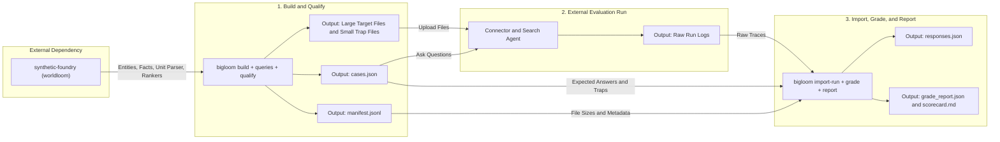
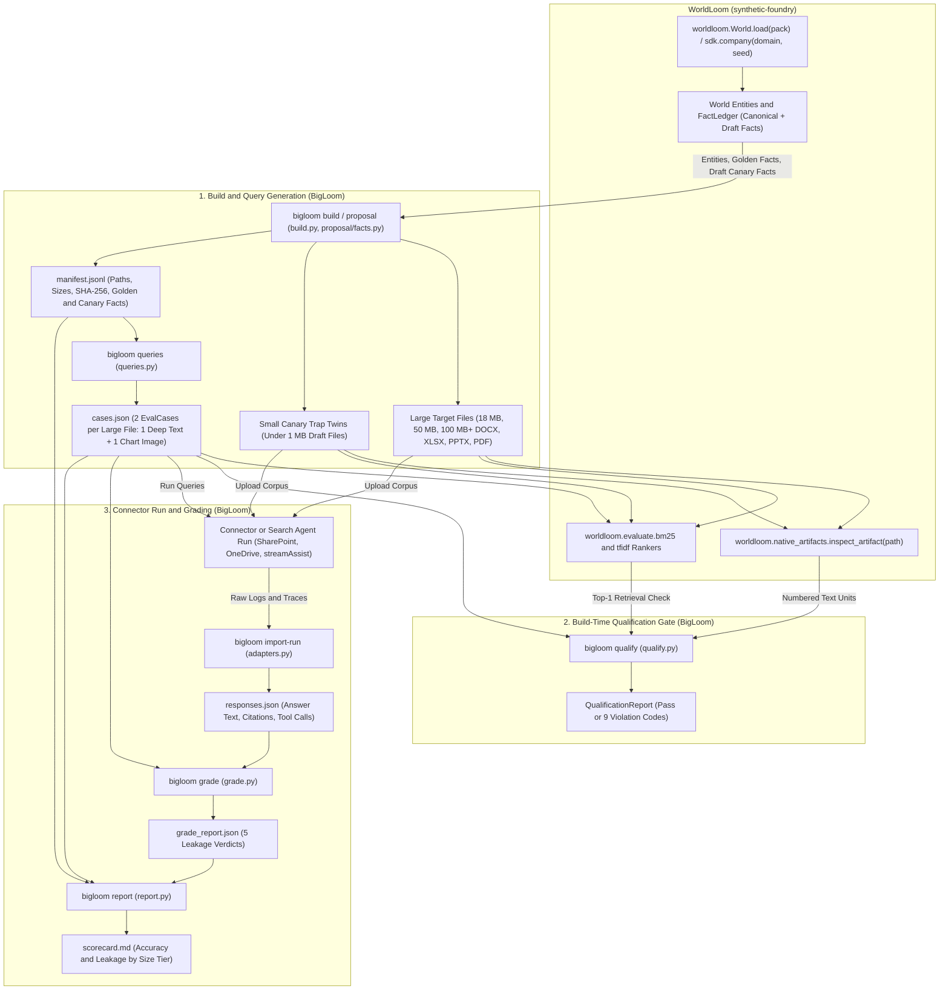

# BigLoom

BigLoom builds large test files (1 MB to 1 GiB across `.docx`, `.xlsx`, `.pptx`, and `.pdf`) on top of [WorldLoom (`synthetic-foundry`)](https://github.com/vamsiramakrishnan/synthetic-foundry) and prevents target leakage in connector and RAG evaluations.

## Overview: Dependencies, Inputs, and Outputs

BigLoom connects two external systems: [`synthetic-foundry`](https://github.com/vamsiramakrishnan/synthetic-foundry) (imported as `worldloom`) for corpus synthesis and qualification, and the connector or search agent under test for evaluation.



| Phase | External Dependency | Input | BigLoom Commands | Output |
| :--- | :--- | :--- | :--- | :--- |
| **1. Build and Qualify** | `synthetic-foundry` (`worldloom`) | CLI flags (`--world-pack`, `--domain`, `--sizes-mb`, `--seed`) | `bigloom build`, `bigloom queries`, `bigloom qualify` | Large target files, `< 1 MB` trap files, `manifest.jsonl`, `cases.json` |
| **2. Evaluation Run** | Connector and Search Agent (such as SharePoint + `streamAssist`) | Large target files, `< 1 MB` trap files, `cases.json` | External runner (or `harnesses/gemini_enterprise/`) | Raw run logs (`.jsonl`, `.json`, or `.csv`) |
| **3. Grade and Report** | None | Raw run logs, `cases.json`, `manifest.jsonl` | `bigloom import-run`, `bigloom grade`, `bigloom report` | `responses.json`, `grade_report.json`, `scorecard.md` |

## Prerequisite Dependency: `synthetic-foundry` (`worldloom`)

BigLoom requires the [`synthetic-foundry`](https://github.com/vamsiramakrishnan/synthetic-foundry) package (imported in Python as `worldloom`). This package is not published on PyPI. You must install it from a local clone before you run `bigloom`.

BigLoom uses three modules from `worldloom`:

| `worldloom` Module | BigLoom Consumer | How BigLoom Uses It |
| :--- | :--- | :--- |
| `worldloom.World` and `worldloom.sdk.company` | `src/bigloom/build.py`, `src/bigloom/proposal/facts.py` | Loads enterprise blueprints, company entities, cost centres, and the `FactLedger` (canonical facts for the large file and draft predecessor facts for the `< 1 MB` trap file). |
| `worldloom.native_artifacts.inspect_artifact` | `src/bigloom/qualify.py` | Parses rendered `.docx`, `.xlsx`, and `.pptx` files into numbered text units (paragraphs, sheets, or slides) to verify deep fact placement (`unit >= 5`), global uniqueness, and image-fact isolation. |
| `worldloom.evaluate.bm25` and `worldloom.evaluate.tfidf` | `src/bigloom/qualify.py` | Ranks every file in the corpus against each evaluation query to confirm that the large target file ranks first (`#1`). |

### Detailed Data Flow from WorldLoom into BigLoom

The diagram below shows how each `worldloom` module connects to the six stages of BigLoom and the generated files between them:

1. **Blueprint and Fact Extraction:** `worldloom.World.load` and `worldloom.sdk.company` pass enterprise entities, canonical golden facts, and draft canary facts into `bigloom build`.
2. **Corpus and Case Generation:** `bigloom build` renders the large target files (`18 MB`, `50 MB`, `100 MB+`) and `< 1 MB` trap twins and writes `manifest.jsonl`. Next, `bigloom queries` reads `manifest.jsonl` and writes two `EvalCase` objects per large file (`1 text` and `1 image`) to `cases.json`.
3. **Qualification Gate:** Before you upload files to a connector, `bigloom qualify` inspects the rendered files with `worldloom.native_artifacts.inspect_artifact` and ranks the corpus with `worldloom.evaluate.bm25` and `worldloom.evaluate.tfidf` to verify all nine anti-leakage rules.
4. **Connector Evaluation and Grading:** After the connector and search agent run against the uploaded files and `cases.json`, `bigloom import-run` normalizes the raw logs into `responses.json`, `bigloom grade` classifies each answer into five leakage verdicts in `grade_report.json`, and `bigloom report` joins `cases.json`, `manifest.jsonl`, and `grade_report.json` to write `scorecard.md`.



## Problem

When you evaluate a connector or search agent on large files (such as 18 MB, 50 MB, and 100 MB DOCX, XLSX, PPTX, and PDF files), target leakage happens in two ways:

1. **Cross-file leakage:** The connector indexes every file in the workspace. A small file (under 1 MB) can contain the same number or topic as a 50 MB file. The agent then answers the 50 MB question from the small file.
2. **Snippet leakage:** The search index returns an early paragraph or title snippet from the large file. The agent answers the question from the snippet without calling `download_document` or `fetch_documents`.

## Offline Pipeline

BigLoom runs offline in six stages:

| Stage | Module | What It Does |
| :--- | :--- | :--- |
| **1. Build large files** | `src/bigloom/build.py` | Renders `.docx`, `.xlsx`, `.pptx`, and `.pdf` files at requested byte sizes (`--sizes-mb`), creates one `< 1 MB` canary trap file per large file, and writes `manifest.jsonl`. |
| **2. Generate queries** | `src/bigloom/queries.py` | Reads `manifest.jsonl` and generates `cases.json` with two high-entropy questions per large file (one deep `text` fact at `unit >= 5` and one `image` chart fact). |
| **3. Qualify corpus** | `src/bigloom/qualify.py` | Uses `worldloom.native_artifacts.inspect_artifact`, `pypdf`, and `worldloom.evaluate.{bm25,tfidf}` to check high entropy, global answer uniqueness, deep placement, image-only text exclusion, canary isolation, and retrieval ranking. |
| **4. Import run logs** | `src/bigloom/adapters.py` | Converts vendor-neutral JSON/JSONL logs, OpenAI/MCP message traces, and CSV evaluation tables into `responses.json`. |
| **5. Grade responses** | `src/bigloom/grade.py` | Grades each query response into `CORRECT_WITH_DOWNLOAD`, `SNIPPET_ONLY_LEAK`, `CROSS_FILE_LEAK_CANARY`, `CROSS_FILE_LEAK_CITATION`, or `WRONG_ANSWER`. |
| **6. Render scorecard** | `src/bigloom/report.py` | Builds a Markdown scorecard (`scorecard.md`) grouped by file size tier (`18 MB`, `50 MB`, `100 MB`), document format, and modality. |

## Generated Files Reference

The pipeline passes data between stages through five files:

| File | Produced By | Consumed By | What It Contains |
| :--- | :--- | :--- | :--- |
| `manifest.jsonl` | `bigloom build` | `bigloom queries`, `bigloom report`, `upload_m365.py` | One JSON line per large file (`ManifestEntry`). Records the large `target_file` path, byte size, and SHA-256 hash, the paired `< 1 MB` `distractor_file` path, byte size, and SHA-256 hash, the planted `text_golden_value` and `image_golden_value` in the large file, and the planted `text_canary_value` and `image_canary_value` in the small trap file. |
| `cases.json` | `bigloom queries` | `bigloom qualify`, `bigloom import-run`, `bigloom grade`, `bigloom report` | A JSON array of `EvalCase` objects (two questions per large file: one `text` and one `image`). Each case holds the question `query`, the expected `target_file`, the `golden_value`, the minimum allowed text unit index (`min_unit_index`), and the `canary_trap` value from the small distractor file. |
| `responses.json` | `bigloom import-run` (or a harness) | `bigloom grade` | A JSON array of `EvalResponse` objects captured from the system under test. Each entry records `case_id`, `answer_text`, `cited_files`, and `tool_calls` (such as `download_document`). |
| `grade_report.json` | `bigloom grade` | `bigloom report` | A `GradeReport` JSON object containing total counts and per-case verdicts (`CORRECT_WITH_DOWNLOAD`, `SNIPPET_ONLY_LEAK`, `CROSS_FILE_LEAK_CANARY`, `CROSS_FILE_LEAK_CITATION`, or `WRONG_ANSWER`). |
| `scorecard.md` | `bigloom report` | Human reader | A Markdown report showing accuracy and leakage rates across file size tiers, document formats, and modalities. |

### Example `manifest.jsonl` Record (`ManifestEntry`)

```json
{
  "file_id": "docx_18mb",
  "format": "docx",
  "target_file": "target_docx_18mb.docx",
  "target_size_bytes": 18874512,
  "target_sha256": "a3f5...",
  "distractor_file": "trap_docx_18mb_draft.docx",
  "distractor_size_bytes": 42180,
  "distractor_sha256": "91c2...",
  "topic": "Meridian Ledger Close",
  "period": "FY2026-Q4",
  "distractor_period": "FY2025-Q1 Preliminary Draft",
  "text_metric_label": "Reconciliation Settlement Token",
  "text_golden_value": "RST-2026Q4-849201",
  "text_canary_value": "RST-2025Q1-193847",
  "text_unit_index": 7,
  "image_chart_title": "Regional Variance Breakdown",
  "image_golden_value": "RVB-994120",
  "image_canary_value": "RVB-112094"
}
```

## Quick Start

Clone `synthetic-foundry` next to `bigloom` and install both packages in a virtual environment:

```bash
git clone https://github.com/vamsiramakrishnan/synthetic-foundry.git ../synthetic-foundry
python3 -m venv .venv
.venv/bin/pip install -e "../synthetic-foundry[docx,pptx,xlsx,pdf]"
.venv/bin/pip install -e ".[dev]"
.venv/bin/pytest
```

## Configuring Your Synthetic Company (Four Input Modes)

You do not need to run `worldloom` manually before you run `bigloom`. BigLoom calls the WorldLoom Python SDK (`worldloom.sdk.company` and `worldloom.World.load`) in the backend. You can supply company inputs in four ways:

| Input Mode | CLI Flag or Command | When to Use It |
| :--- | :--- | :--- |
| **1. Interactive Wizard (`bigloom init`)** | `bigloom init --out ./my-run` | Prompts you for company identity, divisions, and optional advanced WorldLoom blueprint settings (revenue, headcount, fiscal year, locale, headquarters, regions, estate size, system brands, employee name pools, executive voice, facets, and lore), validates `org-pack.json` with `worldloom.packs.lint`, and runs WorldLoom and BigLoom automatically. |
| **2. Industry Domain Preset (`--domain`)** | `--domain retail --locale singapore --facets listing=state_owned,scale=enterprise` | Generates a synthetic company on the fly for a standard industry domain (`retail`, `banking`, `insurance`, `procurement`) with optional locale and facet claims. |
| **3. Bundled or Custom Org Pack (`--world-pack`)** | `--world-pack retail-close` or `--world-pack ./org-pack.json` | Uses a bundled WorldLoom pack or your own custom `.json` organisation pack. |
| **4. Pre-built Corpus Directory (`--corpus-dir`)** | `--corpus-dir /path/to/worldloom_corpus` | Loads an existing directory produced earlier by `worldloom build` or `worldloom demo`. |

### `bigloom init` Interactive Prompts and Default Values

When you run `bigloom init` and press `Enter` at each prompt, the wizard uses these 11 defaults:

| Order | Prompt in `src/bigloom/wizard.py` | Default Selected by `Enter` |
| :--- | :--- | :--- |
| **1** | `1. Company source` | `custom` |
| **2** | `Company / agency name` | `Merlion Sovereign Cloud` |
| **3** | `Industry / sector` | `Public Sector Digital` |
| **4** | `Base WorldLoom domain` | `retail` |
| **5** | `Currency (3-letter ISO code)` | `SGD` |
| **6** | `Divisions / business units` | `Core Platform Division, Cyber Defence Division, Data Services Division` |
| **7** | `Configure advanced WorldLoom blueprint options? [y/N]` | `No` (uses default scale, Singapore geography, 5 systems, 24 staff names, and lore) |
| **8** | `2. Programme or topic title` | `Greater Southern Waterfront Digital Twin Programme` |
| **9** | `3. Target file sizes in MiB` | `18,50,100` |
| **10** | `4. Document formats` | `docx,xlsx,pptx,pdf` |
| **11** | `5. Run WorldLoom, build the files, and verify zero target leakage now? [Y/n]` | `Yes` |

### WorldLoom Company Pack Fields (`org-pack.json`) and Blueprint Dimensions

When you run `bigloom init` (or write an `org-pack.json` file and `proposal-spec.yaml`), WorldLoom accepts the following company pack fields and blueprint dimensions:

| Category | Fields / Flags | Allowed Values or Examples |
| :--- | :--- | :--- |
| **Core Identity** | `company_name`, `industry`, `base`, `currency`, `units` | `"Government Technology Agency (Synthetic)"`, `base`: `retail`, `banking`, `insurance`, `procurement`, `currency`: `"SGD"` |
| **Scale and Calendar** | `annual_revenue`, `employees`, `fiscal_year_start_month`, `seasonality` | `1700000` (in thousands), `3900` employees, month `4` (April), `seasonality`: `flat`, `christmas`, `summer` |
| **Geography and Locale** | `locale`, `headquarters`, `regions` | `locale`: `singapore`, `australia`, `united_kingdom`, `germany`, `japan`, `india`, `china`, `hong_kong`, `malaysia`, `indonesia`, `taiwan`, `gulf` |
| **Technology Estate** | `estate`, `landscape`, `system_brands` | `estate`: `small`, `medium`, `large` (up to 12 core systems and 80 microservices) |
| **People and Voice** | `name_pools` (`given`, `family`), `voices` (`cfo`) | At least 24 given names and 24 family surnames, plus executive tone and recurring phrases |
| **Company Facets** | `facets` (`--facets key=value,...`) | `listing` (`unlisted`, `listed`, `mutual`, `state_owned`), `governance` (`professional`, `founder_led`, `private_equity`), `scale` (`startup`, `midmarket`, `enterprise`, `multinational`), `maturity` (`young`, `established`, `legacy`), `competition` (`monopoly`, `concentrated`, `fragmented`), `margin_profile` (`commodity`, `standard`, `premium`), `trading_pattern` (`steady`, `christmas_peak`, `southern_summer`, `seasonal`, `sales_calendar`) |
| **Historical Lore** | `lore` (`decision`, `norm`) | Past decisions and norms that constrain `event_likelihood` (such as `data_quality_incident/inventory`) or `terminology` |

### WorldLoom Standalone CLI (`worldloom`)

Installing `synthetic-foundry` also installs the standalone `worldloom` CLI in `.venv/bin/worldloom`. You can use it to inspect or author packs directly:

| `worldloom` Command | What It Does |
| :--- | :--- |
| `worldloom pack list` | Lists all bundled WorldLoom packs. |
| `worldloom pack template` | Prints a starter JSON organisation pack template (`company_name`, `industry`, `currency`, `units`, `lore`). |
| `worldloom pack facets` / `locales` / `landscapes` / `targets` | Lists all supported facets, jurisdictions, system landscapes, and lore targets per engine. |
| `worldloom pack lint <file.json>` | Validates a custom `.json` organisation pack against the WorldLoom schema and lore engine. |
| `worldloom build --domain retail --out ./corpus` | Builds and validates a standalone WorldLoom corpus directory on disk. |
| `worldloom inspect <corpus_dir>` | Summarises the company, business units, systems, and fact counts in a corpus. |

## CLI Commands

```bash
# 0. Interactive wizard: asks company questions, builds files up to 1 GiB, and qualifies the corpus
bigloom init --out ./runs/merlion-vault --sizes-mb 18,50,100 --formats docx,xlsx,pptx,pdf --seed 2026

# 1. Build large target files (up to 1024 MiB / 1 GiB), < 1 MB distractor traps, and manifest.jsonl
bigloom build --out-dir ./runs/merlion-vault --sizes-mb 18,50,100,500,1024 --formats docx,xlsx,pptx,pdf --world-pack retail-close --seed 42
bigloom build --out-dir ./runs/custom-vault --sizes-mb 50,200 --formats docx,pdf --domain retail --locale singapore --facets listing=state_owned,scale=enterprise --seed 42

# 2. Generate two evaluation cases per large file (cases.json and evals.csv) from manifest.jsonl
bigloom queries --manifest ./runs/merlion-vault/manifest.jsonl --out ./runs/merlion-vault/cases.json

# 3. Qualify the rendered directory and dataset before uploading to a connector
bigloom qualify --corpus-dir ./runs/merlion-vault --cases ./runs/merlion-vault/cases.json

# 4. Import saved evaluation logs (JSON, JSONL, agent traces, or CSV) into responses.json
bigloom import-run --input ./raw_logs.jsonl --cases ./runs/merlion-vault/cases.json --out ./responses.json

# 5. Grade a completed evaluation run and detect target leakage
bigloom grade --cases ./runs/merlion-vault/cases.json --responses ./responses.json > ./grade_report.json

# 6. Render a Markdown scorecard by size tier, format, and modality
bigloom report --cases ./runs/merlion-vault/cases.json --grade-report ./grade_report.json --manifest ./runs/merlion-vault/manifest.jsonl --out ./scorecard.md
```

## SharePoint and OneDrive Upload Helpers (`utils/`)

The `utils/` folder contains standard-library helpers adapted from `sharepoint-research` to upload `large/` and `traps/` files to Microsoft SharePoint or OneDrive via Microsoft Graph:

- `utils/upload_to_sharepoint.py`: Uploads a BigLoom run folder (`--source`) or `manifest.jsonl` (`--manifest`) using `3.75 MiB` resumable upload sessions for files over `4 MiB` and verifies remote file sizes.
- `utils/inventory_sharepoint.py`: Lists remote files and folders recursively or resolves direct `webUrl` links (`--resolve-url`).
- `utils/sharepoint.env.example`: Template for `sharepoint.env` or `.env`.

```bash
# Dry run (shows the upload plan without modifying SharePoint)
python3 utils/upload_to_sharepoint.py --source ./runs/trial-5mb

# Upload large/ and traps/ files and verify remote sizes
python3 utils/upload_to_sharepoint.py --source ./runs/trial-5mb --target-folder BigLoom-Trial --upload

# List uploaded files and their SharePoint webUrl links
python3 utils/inventory_sharepoint.py --folder BigLoom-Trial
```

## Evaluation Harnesses

Vendor-specific runners live under `harnesses/` so the core `bigloom` package stays independent of any cloud vendor:

- **[`harnesses/gemini_enterprise/`](./harnesses/gemini_enterprise/README.md):** Uploads the files listed in `manifest.jsonl` to SharePoint or OneDrive via Microsoft Graph, runs `cases.json` against Discovery Engine `streamAssist`, exports `responses.json`, and grades runs with `bigloom grade` and `gemini-3.8-flash`.


