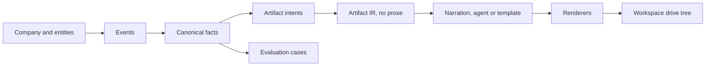

# WorldLoom Repository Report and Recommended Specs for BigLoom

- **Date:** 16 Oct 2026 11:40 SGT
- **WorldLoom path:** `/usr/local/google/home/weizhongt/coding/sharepoint-research/worldloom/synthetic-foundry`
- **WorldLoom commit:** `3fcf194` (merge of PR #63, 28 Sep 2026 07:25 SGT). Nothing is on PyPI, so BigLoom must pin this commit.
- **Size:** 418 Python files, about 201,000 lines, 50 docs, 19 agent skills, 14 connector definitions.
- **Sources:** Six subagents read the code and the docs. Five did targeted research. One ran the `repo-research` skill. Every fact has a file and line reference. Paths start at `src/worldloom/` unless they start with `docs/`, `.claude/`, or a root file name.

## Contents

1. Recommended specs for BigLoom
2. Main findings
3. WorldLoom project context (repo-research)
4. Detailed findings
5. BigLoom audit
6. Reuse map
7. Where the sources disagree
8. Limits and risks
9. Corrections to my earlier statements

---

# Part 1. Recommended Specs for BigLoom

## 1.1 The specs on one page

| # | Spec | What changes | What BigLoom removes | Depends on |
| :--- | :--- | :--- | :--- | :--- |
| 1 | Corpus as input | BigLoom reads a WorldLoom corpus folder. It does not build worlds. | `default_world()`, `_extract_world_pools`, the world parts of the wizard | None |
| 2 | Company pack with document types | Written realism moves into a WorldLoom pack as JSON data | Wizard defaults, `proposal/facts.py` name lists | Spec 1 |
| 3 | Narration through WorldLoom | Prose comes from an agent through the WorldLoom handshake, with a template fallback | `Writer` and its 4 sentence templates | Spec 1, Spec 2 |
| 4 | Render through WorldLoom, then add test evidence | WorldLoom renderers write the files. BigLoom adds the golden fact, the image fact, the trap, and the padding. | `_render_docx`, `_render_pdf`, `_render_pptx`, `_render_xlsx`, most of `charts.py` | Spec 3 |
| 5 | Qualification v2 | The gate checks that search finds both target and trap, and checks realism | The rank-first rule and the header repeats it caused | Spec 4 |
| 6 | Natural questions | Questions use the document subject and the fact kind | "Authorized Capital Reserve", "Q4 Peak Thermal Efficiency", "Final Audit Report" | Spec 4 |
| 7 | Fold or retire the proposal path | `bigloom proposal` becomes one more document type, or goes away | `proposal/` fixed chapters, names, plates, and paragraph template | Spec 2 to Spec 4 |

**BigLoom keeps:** golden and canary values, target and trap pairs, byte padding, the qualification gate, the `streamAssist` harness, download detection, `bigloom grade`, and the SharePoint upload. WorldLoom has no equivalent for these parts.

**The rule for every spec:** BigLoom chooses and arranges WorldLoom output. BigLoom does not write content of its own. Written content that a person chooses goes into a WorldLoom pack, not into Python code.

## 1.2 Spec details

### Spec 1. Corpus as input

**Problem.** BigLoom builds its own world in `prose_writer.default_world()` and copies strings out of it. It ignores the WorldLoom corpus format, the renderers, and the ledger.

**Requirements.**

1. `bigloom build --corpus ./corpus` reads a WorldLoom corpus: `world.json`, `facts.jsonl`, `artifact-ir.jsonl`, `artifact-manifest.jsonl`, `generation-ledger.jsonl` (`corpus.py:41-74`).
2. BigLoom loads it with `World.load(path)` (`world.py:150-200`).
3. The wizard writes a pack or a company specification. It then runs `worldloom build` and `worldloom narrate` (Spec 3). It does not build a world in Python.
4. BigLoom records the WorldLoom commit, seed, recipe digest, model ID, and prompt version in `manifest.jsonl`.

**Acceptance.** A test builds a corpus with `worldloom build --seed 8128 --incident --out ./corpus`, and `bigloom build --corpus ./corpus` reads it with no world code in BigLoom.

### Spec 2. Company pack with document types

**Problem.** The older files were good because a person chose 16 real document types, sections, and sentences. The 14 Oct track removed that content to meet "zero hardcoded lists". The content must return, but as data in a WorldLoom pack.

**Requirements.**

1. A GovTech pack (`kind: company`, base `retail`) holds the company, units, name pools, system brands, voices, and lore (`packs.py:281-499`).
2. The pack declares document types in `artifact_types`, for example a board paper, an incident review, a procurement register, and an architecture review (`packs.py:371-388`). Use the `worldloom-doctypes` skill.
3. The pack sets the narration wording in `episode_text` and the question wording in `evaluation_text` (`packs.py:321-334`).
4. `worldloom pack check` and `worldloom pack lint` must pass.
5. Retail and banking presets stay available for private-sector runs. GovTech terms stay inside the GovTech pack.

**Acceptance.** `worldloom build --pack govtech` makes at least 16 distinct document types. No GovTech term appears in a `retail` build.

### Spec 3. Narration through WorldLoom

**Problem.** BigLoom writes most of its prose from 4 sentence templates.

**Requirements.**

1. The default realism profile is `enterprise/v2` (`realism_profiles.py:83-97`).
2. **Jetski path:** the file handshake. `worldloom narrate requests ./corpus -o requests.json`, the agent writes `responses.json`, then `worldloom narrate accept ./corpus --from responses.json --model-id <id> --json`. Repeat until all sections pass.
3. **Claude Code or Codex path:** `worldloom narrate loop ./corpus --harness claude` (or `codex`).
4. **Test and no-model path:** `ComposedProvider` (`narrative/composer.py:754-802`).
5. The ledger stays with the corpus. Later builds replay it with no model calls.
6. A thin BigLoom skill tells the agent to use the WorldLoom `worldloom` and `worldloom-artifact-realism` skills. It adds only the BigLoom test steps. It does not restate the prose rules, because the request document carries them.

**Acceptance.** `prose_quality` reports no template openers above its threshold and no repeated sentences (`prose_quality.py:1-46`). A replay build makes the same text with no model calls.

### Spec 4. Render through WorldLoom, then add test evidence

**Problem.** BigLoom writes its own layout, so every file looks the same and PDF pages are almost empty.

**Requirements.**

1. Render each target document with the WorldLoom enterprise renderer: DOCX (`render/enterprise/docx.py:409`), PDF (`render/enterprise/pdf.py`), PPTX (`render/enterprise/pptx.py:51`). Use `render/xlsx.py:209` with detail tables for XLSX.
2. **Text fact:** add a BigLoom table section to the IR at unit 6 or deeper, before rendering. The IR is a pydantic model, so BigLoom adds the section to a copy.
3. **Image fact:** add a picture after rendering, because no WorldLoom renderer embeds pictures. Use a picture part for DOCX and PPTX, and an image page for PDF.
4. **Trap file:** build `--distractors N`, then take the superseded draft of the same document (`generators/distractors.py:142-204`). Add the canary value to the draft.
5. **Padding:** add media or an unreferenced ZIP member for DOCX, PPTX, and XLSX (the `_pad_ooxml` method, `artifact_shape_materialize.py:78-103`). Add an embedded file stream for PDF. Use XLSX detail rows first.
6. Set a different `style_seed` for each document, so files in one world do not share one look (`compiler/style.py:75-98`).

**Acceptance.** Each target has a cover, contents, numbered sections, and native charts. The text fact sits at unit 6 or deeper. The trap has the same title family and an older date.

### Spec 5. Qualification v2

**Problem.** The rank-first rule (`core_pipeline_20261002/spec.md:26`) made `build.py` repeat the header in every paragraph and caption. `product.md` asks that search returns both the target and the trap. It does not ask for rank first.

**Requirements.**

1. Replace `TARGET_NOT_RANKED_FIRST` with a rule that the target and its trap both rank in the top 3 for a natural query.
2. Get the fact depth from renderer locators, for example `paragraph:N` (`native_corpus.py:43-50`), not from a manual counter.
3. Add realism checks: repeated sentences, template openers, header repeats, cut words, and pages with fewer than 40 words.
4. Add a reader for files above 512 MiB, because `inspect_artifact` refuses them (`native_artifacts.py:46-47`). Add a PDF reader too.
5. Update `tests/test_qualify.py:113-151`. Its clean fixture repeats the topic in all 6 paragraphs, and this locks the old pattern in.

**Acceptance.** The 1 MB and 18 MB sets pass in all four formats with no header repeats.

### Spec 6. Natural questions

**Requirements.**

1. The subject comes from the document title and type in the IR.
2. The metric label comes from the fact kind (`measure_noun`).
3. The question wording comes from the pack `evaluation_text`.
4. Remove the fixed labels and the double topic in `queries.py:39-42` and `queries.py:55-58`.

**Acceptance.** No two questions in one set share a fixed label.

### Spec 7. Fold or retire the proposal path

**Problem.** `bigloom proposal` has its own fixed chapters (`proposal/spec.py:52-72`), name lists (`proposal/facts.py:19-70`), plates (`proposal/plates.py`), and one paragraph template used 6 times for each section (`proposal/prose.py:193-201`). Its default prose provider is the template, not Gemini (`proposal/spec.py:33`).

**Options.**

1. Fold it into Specs 2 to 4 as a funding proposal document type with `size_profile xlong` or a pack `SizeBudget`.
2. Retire it.

**Decision needed from you.**

---

# Part 2. Main Findings

1. **WorldLoom never calls a model.** The agent is the writer. WorldLoom sends bounded requests, checks each reply against the facts, and stores accepted prose in a ledger (`AGENTS.md:13-27`).
2. **WorldLoom already makes realistic documents.** `enterprise/v2` gives long-document structure, a cover, document control, revision history, contents, native charts, and appendices.
3. **BigLoom uses almost none of it.** BigLoom does not use the WorldLoom renderers, the narration loop, document types, distractors, or evaluation text.
4. **The older good files did not come from WorldLoom.** `make_large_files.py` and `make_gsw_proposal.py` do not import WorldLoom. A person wrote the document catalogue and the sentences. Gemini wrote the proposal sections.
5. **The rank-first gate caused the keyword stuffing.** No spec gives a reason for it, and `product.md` does not ask for it.
6. **"Zero hardcoded lists" removed the realism.** Written content must move into a pack, not disappear.
7. **WorldLoom cannot make 1 GiB files.** BigLoom must own byte padding, PDF padding, and a large-file reader.
8. **WorldLoom has no path to the real SharePoint connector.** It exports to Discovery Engine and emulates SharePoint. The BigLoom upload and `streamAssist` harness stay.

---

# Part 3. WorldLoom Project Context (repo-research)

The `repo-research` skill produced this part. I resolved two of its open questions from the other reports. This part will also go to `conductor/worldloom-context.md` in BigLoom after your review.

Source document: `worldloom_project_context.md`. Commit `3fcf194`. Written by the `repo-research` skill.

### Project Identity

- **Name:** `worldloom`. The repository, the Python package, and the command share this name (`pyproject.toml:6`, `README.md:13`).
- **Type:** Python library plus Typer CLI. The console script is `worldloom = "worldloom.cli:app"` (`pyproject.toml:131-132`).
- **Purpose:** It generates a synthetic enterprise world (company, facts, events, history). It then renders that state into workbooks, documents, slides, PDFs, tickets, and knowledge pages, plus evaluation cases tied to the evidence (`README.md:3-7`, `pyproject.toml:10`).
- **Domain:** Synthetic data for retrieval, RAG, document extraction, temporal questions, and agent workflow evaluation (`README.md:9-11`, `pyproject.toml:18-27`).
- **Version and status:** `0.1.0`, unreleased, Alpha. Nothing is on PyPI. Every install starts from a checkout (`src/worldloom/__init__.py:153`, `README.md:30-31`, `pyproject.toml:29-32`).
- **Licence and author:** Apache-2.0. Author Vamsi Ramakrishnan. Upstream `https://github.com/vamsiramakrishnan/worldloom` (`pyproject.toml:12-16`, `pyproject.toml:62`).
- **Key design rule:** The library never calls a language model. A coding harness (the "agent") writes the prose. WorldLoom checks that prose against the world (`README.md:31`, `AGENTS.md:13-24`, `pyproject.toml:79-80`).
- **Determinism:** A corpus replays byte for byte from `seed + recipe + generation ledger`. CI rebuilds corpora and compares bytes on every push (`AGENTS.md:29-30`).

### Project Structure (Repo Map)

Source: `find . -maxdepth 3` and `ls` output, Phase 1. The agent read no source file in Phase 1.

| Path | Kind | Notes |
| --- | --- | --- |
| `pyproject.toml` | Root config | Python package metadata. |
| `README.md`, `AGENTS.md`, `CLAUDE.md`, `CONTRIBUTING.md`, `RELEASING.md`, `SECURITY.md` | Documentation | `CHANGELOG.md` is 251 KB. |
| `Dockerfile`, `.dockerignore` | Infrastructure | Container build. |
| `.mcp.json` | Infrastructure | MCP server registration for agents. |
| `.pre-commit-config.yaml` | Tooling | Pre-commit hooks. |
| `.github/workflows/` | CI | `ci.yml`, `determinism-sweep.yml`, `docs.yml`, `process-bindings-check.yml`, `release.yml`, `slow-tests.yml`. |
| `.claude/commands/` | Agent commands | `worldloom-act`, `-build`, `-design`, `-evalrun`, `-evaluate`, `-narrate`, `-render`. |
| `.claude/skills/` | Agent skills | 19 skills, for example `worldloom-sdk`, `worldloom-packs`, `worldloom-synthesis`. |
| `docs/` | Documentation | About 50 pages. Examples: `architecture.md`, `connector-serving.md`, `enterprise-corpus.md`, `gemini-enterprise.md`, `sdk.md`, `studio.md`. |
| `site/` | Docs site | Astro site (`astro.config.mjs`, `package.json`). |
| `src/worldloom/` | Python package | 204 entries at top level. |
| `src/worldloom/cli.py` | Entry point | Main CLI (candidate). |
| `src/worldloom/mcp.py` | Entry point | MCP server (candidate). |
| `src/worldloom/*_cli.py` | Sub-app entry points | `connector_serving_cli`, `contracts_cli`, `dataset_cli`, `enterprise_qualification_cli`, `interview_cli`, `packkit_cli`, `quality_cli`, `seams_cli`, `studio_cli`, `synthesis_cli`. |
| `src/worldloom/sdk.py`, `enterprise_sdk.py` | Python API | SDK surface (candidate). |
| `src/worldloom/models.py`, `world.py`, `company.py` | Data model | Candidate schema files. |
| `src/worldloom/connector_*.py` | Connector layer | `connector_data`, `_definition`, `_emulator`, `_eval_runtime`, `_fields`, `_keys`, `_payload`, `_projection`, `_query`, `_realism`, `_results`, `_seed`, `_trace`. |
| `src/worldloom/connectors/` | Connector layer | `anvil.py`, `anvil_provider.py`, `anvil_surface.mjs`, `contracts.py`, `enterprise.py`, `serving.py`, `surface.py`, `query/`. |
| `src/worldloom/render/` | Artifact renderers | `docx.py`, `pptx.py`, `xlsx.py`, `pdf.py`, `html.py`, `markdown.py`, `ooxml.py`, `bundles.py`, `enterprise/`. |
| `src/worldloom/studio/` | Studio web app | `server.py`, `service.py`, `store.py`, `worker.py`, `static/`. |
| `src/worldloom/gemini_enterprise/` | GE integration | `cli.py`, `datastore.py`, `cases.py`, `results.py`. |
| `src/worldloom/evalrun/` | Eval runner | 35 modules, for example `runner.py`, `grader.py`, `cli.py`. |
| `src/worldloom/compiler/`, `pipeline/`, `generators/`, `narrative/`, `synthesis/`, `interview/`, `packkit/`, `process_bindings/`, `actors/`, `evaluate/`, `evals/` | Subsystems | Generation and evaluation subsystems. |
| `src/worldloom/_data/`, `src/worldloom/data/` | Package data | `_data` has 144 files: `artifact-types`, `connectors`, `packs`, `pcf`, `onet`, `locales`, `process-catalogue`, and more. |
| `examples/` | Sample inputs | `hospital/`, `retail-close/` (world plus JSONL ledgers), `packs/`, `enterprise-evals/`, `episodes/`, `studio/`. |
| `evals/` | Repo-level evals | `enterprise_minimum.py`, `executive_narration.py`, `alphaevolve/`. |
| `tools/` | Scripts | Ingest (`ingest_onet.py`, `ingest_apqc.py`), harvest, `build_sor_connector.py`, `measure_*.py`, `sweep.py`. |
| `tests/` | Tests | 347 entries. |

### Technology Stack

| Layer | Technology | Source |
| --- | --- | --- |
| Language | Python 3.11 or later. CI tests 3.11, 3.12, 3.13. | `pyproject.toml:17`, `.github/workflows/ci.yml:95` |
| Build backend | hatchling. Version is read from `src/worldloom/__init__.py`. | `pyproject.toml:1-3`, `pyproject.toml:134-135` |
| Core dependencies | `pydantic>=2.6`, `typer>=0.12`, `rich>=13.0`, `networkx>=3.2`, `numpy>=1.26` | `pyproject.toml:44-59` |
| Renderer extras | `xlsx` (openpyxl), `docx` (python-docx), `pdf` (reportlab), `pptx` (python-pptx) | `pyproject.toml:68-71` |
| Dataframe extras | `polars`, `pandas`, `arrow` (pyarrow) | `pyproject.toml:72-74` |
| MCP extra | `mcp>=2.2,<3`, for `worldloom mcp` over stdio | `pyproject.toml:75-81` |
| Embeddings extra | `model2vec>=0.6`, `huggingface-hub>=0.24`. This is the only part that downloads weights. | `pyproject.toml:82-98` |
| `all` extra | The four renderers plus `mcp` | `pyproject.toml:101-107` |
| `ingest` extra | openpyxl, faker, babel, pycountry, geonamescache, holidays. Used only by `tools/ingest_*.py`. | `pyproject.toml:108-119` |
| `dev` extra | pytest, the renderers, mcp, hypothesis | `pyproject.toml:120-129` |
| Wheel contents | `src/worldloom` plus `examples/` copied to `worldloom/_examples` | `pyproject.toml:137-141` |
| Lint | ruff 0.15.8 (no formatter) | `pyproject.toml:147-204`, `.pre-commit-config.yaml:4-17` |
| Types | mypy 2.3.1, with a module debt list (`ignore_errors`) | `pyproject.toml:218-321`, `.github/workflows/ci.yml:53` |
| Tests | pytest. Slow tests are deselected by default. | `pyproject.toml:323-337` |
| Container | `python:3.12-slim`, two stages. Installs the wheel with `[all]`. | `Dockerfile:16-34` |
| Docs site | Astro 5 plus Starlight, npm, in `site/` | `AGENTS.md:212`, `AGENTS.md:136-137` |
| Concurrency | No async in `src/`. One thread pool in `narrative/compiler.py`, one in `evalrun.runner.run_cases`. | `AGENTS.md:181-183` |

### Configuration

- There is no `.env.example` file. The root has no `.env*` file (Phase 1 `ls -a`).
- `.mcp.json` registers one MCP server named `worldloom`. It runs `worldloom mcp` with an empty `env` (`.mcp.json:1-9`).
- `pyproject.toml` holds all gates: extras, ruff, mypy, and pytest configuration (`AGENTS.md:189`).
- The version is single-sourced in `src/worldloom/__init__.py` (`pyproject.toml:7-9`, `src/worldloom/__init__.py:153`).
- The Studio container uses a `/workspace` volume for company revisions, jobs, and datasets. It exposes port 8765 (`Dockerfile:35-44`).
- Runtime environment variables found in source (detail in the Environment Variable Dependency Chain section):

| Variable | Read at | Default when unset |
| --- | --- | --- |
| `WORLDLOOM_OUTPUT` | `src/worldloom/cli.py:884` | Refusals print as prose. `json` gives one JSON line on stderr. |
| `WORLDLOOM_DATASET_WORKERS` | `src/worldloom/evals/dataset.py:258` | `packkit.policy("dataset.workers")` |
| `WORLDLOOM_STUDIO_HARNESS` | `src/worldloom/studio/worker.py:75`, `src/worldloom/studio/server.py:68-71` | No harness command |
| `WORLDLOOM_VECTOR_CACHE` | `src/worldloom/evaluate/embedding.py:203-207` | `.worldloom/vectors` |
| `WORLDLOOM_CONTRACTS_CACHE` | `src/worldloom/connectors/contracts.py:59`, `:211-215` | `~/.cache/worldloom/contracts` |
| `WORLDLOOM_ANVIL` | `src/worldloom/evalrun/anvil.py:74`, `:86` | `anvil` on `PATH` |
| `--tokens-env <NAME>` (name given by flag) | `src/worldloom/connector_serving_cli.py:19`, `:57-64` | No tokens. A set flag with an unset variable raises `ValueError`. |

### Development Workflow

Commands come from `AGENTS.md:95-108`, `README.md:320-326`, and `.github/workflows/ci.yml`.

| Step | Command | Source |
| --- | --- | --- |
| Install (checkout) | `python -m pip install -e '.[all,dev]'` | `README.md:323` |
| Install hooks | `pre-commit install` (ruff-check plus `worldloom docs --check`) | `AGENTS.md:97`, `.pre-commit-config.yaml:1-31` |
| Check install | `worldloom doctor` (names the missing extra) | `AGENTS.md:98`, `AGENTS.md:207-209` |
| Tests | `pytest -q` (slow tests deselected) | `AGENTS.md:100`, `pyproject.toml:337` |
| Slow tests | `pytest -m slow -q` | `AGENTS.md:102` |
| Lint | `ruff check .` | `AGENTS.md:103` |
| Types | `mypy` | `AGENTS.md:104` |
| Golden corpus | `worldloom validate retail-close` | `AGENTS.md:106`, `.github/workflows/ci.yml:135-136` |
| Docs drift | `worldloom docs --check`. After a CLI change, run `worldloom docs` and commit the new reference. | `AGENTS.md:107`, `AGENTS.md:237-241` |
| Wheel | `pipx run build` | `README.md:63` |
| Container | `docker build -t worldloom .` | `README.md:75` |
| Docs site | `cd site && npm ci && npm run build` | `AGENTS.md:136-137` |

CI jobs in `ci.yml`: `lint` (ruff and mypy on 3.11), `dispersed-replay` (byte identity on 3.12), `test` (pytest matrix, docs check, golden corpus, build and render validation) (`.github/workflows/ci.yml:28-146`).

### Architecture Patterns

- **Layered pipeline around one immutable world.** `World` is a dataclass and the single entry point for load, build, and validate (`AGENTS.md:34-35`, `src/worldloom/world.py:65`, `src/worldloom/world.py:151`, `src/worldloom/world.py:1146`).
- **Thin waist of frozen pydantic models.** Every model uses `ConfigDict(frozen=True, extra="forbid")` (`src/worldloom/models.py:33-40`, `AGENTS.md:36-39`).
- **Pipeline stages** (`AGENTS.md:41-54`):
  1. `generators/` mint entities, facts, and events from recipe steps with seeded RNG streams and `ids.Minter`.
  2. `documents.py` compiles `ArtifactIntent` to `ArtifactIR`. `compiler/` is the deterministic artifact compiler.
  3. `narrative/` takes prose requests, validates claims, and writes the generation ledger.
  4. `render/` turns IR into bytes. `workspace.py` writes a permissioned shared-drive tree.
  5. `validate.py` is the coherence gate. `evaluate/` scores retrieval hardness.
- **Determinism spine.** Generation ledger, recipe, and content-addressed receipts make every corpus replay byte for byte (`AGENTS.md:56-69`). No `random`, `uuid`, wall clock, or builtin `hash()` in `src/` (`AGENTS.md:141-149`).
- **Registration seams.** `register_domain`, `register_step`, `register_domain_checks`, `register_artifact_types`, `registries.declare`, and `narrative/prompts.register`. `__init__._install()` imports every vertical unconditionally (`AGENTS.md:157-163`, `src/worldloom/__init__.py:158`).
- **Thin CLI monolith.** `cli.py` is about 397 KB. It imports lazily inside command bodies. `@app.callback()` runs `_install()` before every command (`AGENTS.md:70-72`, `src/worldloom/cli.py:666`).
- **Agent is the writer.** All write paths use file handshakes (`requests` then `accept`), validated all or nothing (`src/worldloom/mcp.py:3-9`, `AGENTS.md:13-24`).
- **Three library seams** named by `worldloom seams`: `connectors/` (connector emulation and trace grading), `evals/` (eval-first design to proof), `pipeline/` (typed orchestration) (`AGENTS.md:82`, `src/worldloom/cli.py:127`).
- **Data-driven connector emulation.** One emulator reads JSON connector definitions with search, paging, projection, workflows, ACLs, idempotency, faults, and a frozen clock (`README.md:289-294`, `src/worldloom/connector_definition.py:323-350`).
- **Typed errors and stable refusal codes.** `CorpusError`, `CoherenceError`, `RecipeError`, `NarrationError`, `RenderError`, plus `ValidationReport`. CLI refusals use the `_REFUSALS` registry (`AGENTS.md:165-169`, `src/worldloom/cli.py:860-890`).

### External Integrations

| Integration | Direction | How | Source |
| --- | --- | --- | --- |
| Coding harness (`claude`, `codex`) | WorldLoom calls the installed CLI with its own login | `narrate loop --harness`, `evalrun run --harness`, `studio serve --harness` | `README.md:194-206`, `src/worldloom/studio_cli.py:44-75` |
| MCP clients | Client calls WorldLoom | `worldloom mcp` over stdio | `.mcp.json:1-9`, `src/worldloom/mcp.py:725-727` |
| MCP agents over HTTP | Agent calls WorldLoom | `enterprise-evals serve`, StreamableHTTP at `/mcp` | `src/worldloom/connector_serving_cli.py:27-34`, `:82-87` |
| Anvil (vendor API simulator) | WorldLoom starts `anvil simulate serve` per connector per case | `evalrun run --connectors anvil`. CLI found by `WORLDLOOM_ANVIL` or `PATH`. | `src/worldloom/evalrun/anvil.py:1-15`, `:74-90` |
| Gemini Enterprise Eval Studio / Discovery Engine | Export only. WorldLoom writes files. It does not call the API. | `gemini-enterprise datastore` writes `documents.jsonl` (`gcsSource`, `dataSchema: "document"`, `content.uri`, `aclInfo`) | `src/worldloom/gemini_enterprise/cli.py:22-58`, `src/worldloom/gemini_enterprise/datastore.py:1-30` |
| Vendor API contracts (OpenAPI 3, Swagger 2, Discovery) | Fetch and cache | `worldloom contracts fetch/build` | `src/worldloom/connectors/contracts.py:55-62`, `src/worldloom/contracts_cli.py:50-74` |
| Hugging Face Hub (model2vec weights) | Download, optional | `evaluate --retriever embedding` | `pyproject.toml:82-98` |
| Jira, Confluence, ServiceNow | No live call | Rendered bundles only. "Rendering a Jira or ServiceNow bundle does not write to a live tenant." | `README.md:181-187` |
| Language model APIs | None | The package never calls a model service | `README.md:31`, `pyproject.toml:79-80` |

### API Surface / Route Map

#### CLI: top-level commands (`worldloom <command>`)

Root app: `src/worldloom/cli.py:35-39`. Console script: `pyproject.toml:132`.

| Command | Line | Command | Line |
| --- | --- | --- | --- |
| `demo` | `cli.py:1117` | `build` | `cli.py:1144` |
| `render` | `cli.py:4109` | `mosaic` | `cli.py:4206` |
| `inspect` | `cli.py:4662` | `status` | `cli.py:4748` |
| `validate` | `cli.py:4843` | `verify` | `cli.py:4895` |
| `migrate` | `cli.py:5054` | `evolve` | `cli.py:5211` |
| `formats` | `cli.py:5427` | `evaluate` | `cli.py:5464` |
| `search` | `cli.py:5648` | `diversity` | `cli.py:5828` |
| `topology` | `cli.py:6126` | `series` | `cli.py:6215` |
| `mcp` | `cli.py:6380` | `twin` | `cli.py:6415` |
| `mutate` | `cli.py:6520` | `stats` | `cli.py:6649` |
| `fidelity` | `cli.py:6707` | `calibrate` | `cli.py:6774` |
| `actors` | `cli.py:6999` | `workspace` | `cli.py:7792` |
| `archetypes` | `cli.py:7849` | `doctor` | `cli.py:7863` |
| `version` | `cli.py:8018` | `docs` | `cli.py:8024` |
| `spaces` | `cli.py:8186` | `seams` | `cli.py:127` |

Important `build` flags: `--seed`, `--period`, `--out`, `--incident/--no-incident`, `--pack`, `--episode`, `--employees`, `--periods`, `--format/-f`, `--eval-density`, `--narrate`, `--replay`, `--distractors`, `--access`, `--messiness`, `--realism`, `--overwrite` (`src/worldloom/cli.py:1147-1559`). `workspace` takes `--out`, `--overwrite`, and `--noise none|lived_in|neglected` (`src/worldloom/cli.py:7792-7840`).

#### CLI: sub-apps

| Sub-app | Commands | Source |
| --- | --- | --- |
| `evals` | `export`, `construct`, plus `calibration` (`ingest`, `report`) and `dataset` (`compile`, `verify`) | `cli.py:40-41`, `cli.py:5287-5304`, `cli.py:111-112`, `quality_cli.py:167-215`, `dataset_cli.py:13-37` |
| `narrate` | `requests`, `accept`, `loop`, plus `readers` (`requests`, `accept`) | `cli.py:3200-3319`, `cli.py:110`, `quality_cli.py:99-119` |
| `plan` | `requests`, `accept` | `cli.py:3831-3862` |
| `pack` | `check`, `profiles`, `params`, `facets`, `messiness`, `landscapes`, `locales`, `targets`, `texts`, `export`, `spec`, `template`, plus packkit `kinds`, `list`, `show`, `lint`, `install`, `tree`, `from-tree`, `diff`, `author`, `interview request/accept` | `cli.py:7090-7723`, `cli.py:129`, `packkit_cli.py:33-235` |
| `act` | `requests`, `accept` | `cli.py:3955-4019` |
| `compose` | `requests`, `accept` | `cli.py:3440-3478` |
| `probe` | `open`, `next`, `accept`, `show`, `worlds`, `resolve` | `cli.py:3579-3782` |
| `causal` | `check`, `trace` | `cli.py:6857-6897` |
| `present` | `describe`, `brief`, `lint` | `cli.py:8080-8141` |
| `fleet` | `qualify`, `curate` | `cli.py:5100-5167` |
| `benchmark` | `run` | `cli.py:5760` |
| `enterprise-evals` | `space`, `plan`, `housekeeping`, `validate`, `build`, `score`, `simulate`, `serve`, `qualify` | `cli.py:134-520`, `cli.py:108-109` |
| `industry` | `list`, `programme`, `project` | `cli.py:278-335` |
| `synth` | `example`, `check`, `build`, `verify`, `merge`, `intervene`, `compare`, `search`, `team` | `synthesis_cli.py:38-152`, `cli.py:125` |
| `studio` | `serve`, `init`, `show`, `run`, `evalrun`, `next`, `advance`, `prepare-native`, `interview request/accept`, `pack list/install/author/use`, `pack interview request/accept` | `studio_cli.py:11-427`, `cli.py:126` |
| `gemini-enterprise` | `datastore`, `cases`, `score` | `gemini_enterprise/cli.py:16-119`, `cli.py:128` |
| `evalrun` | `cases`, `requests`, `run`, `merge`, `plan`, `summarize`, `compare`, `import-served`, `import-studio`, `agreement`, `autopsy`, `curriculum`, `export`, `improve`, `corners`, `prove`, `frontier`, `value`, `improve-proposer`, `noise`, `campaign` | `evalrun/cli.py:107-1756`, `cli.py:129` |
| `contracts` | `fetch`, `build`, `trim`, `coverage`, `surface` | `contracts_cli.py:50-165`, `cli.py:130` |
| `interview` | `run`, `next`, `answer`, `status`, `build`, `measure` | `interview_cli.py:76-229`, `cli.py:131` |

#### MCP stdio server (`worldloom mcp`)

Transport: stdio (`src/worldloom/mcp.py:725-727`). Needs the `mcp` extra (`src/worldloom/mcp.py:40-57`). The tools are read-only, except the probe tools. The probe tools write only the probe file that the caller names (`src/worldloom/mcp.py:3-26`).

| Tool | Purpose | Line |
| --- | --- | --- |
| `measure_corpus` | Near-duplicate passage groups in a corpus | `mcp.py:329` |
| `corpus_topology` | Dependency graph, services ranked by impact | `mcp.py:344` |
| `corpus_series` | Trend, season, and residual of a fact series | `mcp.py:358` |
| `validate_corpus` | Full coherence gate, violations as data | `mcp.py:378` |
| `probe_open` | Start a probe from a premise | `mcp.py:391` |
| `probe_next` | Next probe question with bounds | `mcp.py:418` |
| `probe_answer` | Answer one probe question | `mcp.py:434` |
| `probe_worlds` | Worlds the probe allows | `mcp.py:525` |
| `probe_resolve` | Turn a settled probe into parameter overrides | `mcp.py:546` |
| `evalrun_cases` | Describe a compiled enterprise case set | `mcp.py:563` |
| `evalrun_run` | Run a built-in agent over the case set | `mcp.py:582` |
| `evalrun_plan` | Grade a planner on the plan axis | `mcp.py:608` |
| `evalrun_summarize` | Summary of a run directory | `mcp.py:633` |
| `evalrun_compare` | Compare two run directories by case | `mcp.py:648` |

#### StreamableHTTP MCP server (`worldloom enterprise-evals serve`)

- Defaults: host `127.0.0.1`, port `8000`, path `/mcp`, uvicorn with one worker (`src/worldloom/connector_serving_cli.py:15-16`, `:82-87`).
- Input: an exported corpus directory or an `EnterpriseCorpus` JSON file (`src/worldloom/connector_serving_cli.py:44-46`).
- A non-loopback host needs bearer tokens of at least 24 characters (`src/worldloom/connectors/serving.py:1204-1210`).
- The ASGI app is stateless HTTP with JSON responses and DNS rebinding protection (`src/worldloom/connectors/serving.py:1326-1340`).
- Run state is in memory. Scale out with `--worker-id` and sticky routing by run id (`src/worldloom/connector_serving_cli.py:23`, `:27-33`).

Evaluation tools (7 registered, `src/worldloom/connectors/serving.py:1235-1259`):

| Tool | Arguments | Read only | Purpose |
| --- | --- | --- | --- |
| `eval_list` | `offset`, `limit` | Yes | List evaluation questions |
| `eval_begin` | `query_id` | No | Start an isolated run. Returns `run_id`. |
| `eval_trace` | `run_id`, `offset`, `limit` | Yes | Read observed tool spans |
| `eval_grade` | `run_id` | Yes | Grade calls and record state |
| `eval_score` | `run_id`, `answer`, `artifacts`, `planned_dag` | Yes | Three-axis grade (plan, trajectory, outcomes) |
| `eval_ask` | `run_id`, `question`, `about` | No | Ask the simulated user a question |
| `eval_end` | `run_id` | No | Grade and release the run |

Connector tools: one tool per connector definition tool, with an extra `run_id` argument. With `--surface contract`, the server serves Anvil contract operations instead (`src/worldloom/connectors/serving.py:1264-1325`, `src/worldloom/connector_serving_cli.py:25`). The docs name connector tools in `connector.tool` form, for example `servicenow.get_record` (`docs/connector-serving.md:21-23`). SharePoint has 17 tools (see Tool Definitions).

Serving limits (defaults from policy `connectors.serving.<limit>`): 32 live runs, 4 runs per principal, 4,096 connector calls per run, 64 KiB request bodies, 1 MiB connector responses, 100,000 initial records, and a ceiling of 100 tools that includes the evaluation tools. An oversized connector response rolls back that call (`docs/connector-serving.md:41-56`). Runs are lost when the process stops. Retrieve the trace before `eval_end` (`docs/connector-serving.md:33-38`).

> The evaluation tool count does not agree across three places. `--check` prints `"evaluation_tools": 5` (`src/worldloom/connector_serving_cli.py:83`). The docs say six (`docs/connector-serving.md:44-45`). The code registers 7, including `eval_ask` (`src/worldloom/connectors/serving.py:1235-1259`). The code is the source of truth.

#### Studio HTTP server (`worldloom studio serve`)

- Defaults: host `127.0.0.1`, port `8765`, workspace `./worldloom-workspace` (`src/worldloom/studio_cli.py:44-48`). The container binds `0.0.0.0:8765` (`Dockerfile:39`, `Dockerfile:44`).
- Server: stdlib `http.server` with a loopback `Host` check. No authentication. Body limit 4,000,000 bytes (`src/worldloom/studio/server.py:9`, `:20-39`, `README.md:79-84`).
- Dispatch: `StudioHandler.dispatch` (`src/worldloom/studio/server.py:154`).

| Method | Path | Line |
| --- | --- | --- |
| GET | `/`, `/app.js`, `/creation.js`, `/style.css` (static) | `server.py:161` |
| GET | `/api/bootstrap` | `server.py:166` |
| GET | `/api/preset` | `server.py:170` |
| GET | `/api/packs` | `server.py:176` |
| GET | `/api/packs/{a}/{b}` | `server.py:180` |
| GET | `/api/jobs/{id}` | `server.py:183` |
| GET | `/api/projects/{id}` | `server.py:199-201` |
| GET | `/api/projects/{id}/workflow`, `/creation`, `/native-sources`, `/native-queryset`, `/agent-results`, `/native-artifact`, `/history`, `/evidence`, `/evals` | `server.py:204-243` |
| POST | `/api/projects` | `server.py:262` |
| POST | `/api/packs` | `server.py:265` |
| POST | `/api/packs/author` | `server.py:269` |
| POST | `/api/jobs/{id}/retry` | `server.py:285` |
| POST | `/api/projects/{id}/{action}`, where action is `revise`, `interview-request`, `interview-accept`, `interview-apply`, `packs`, `select-narration`, `prepare-data`, `prepare-native`, `run` | `server.py:289-330` |

Error codes: 404 route not found, 400 pack refused, 409 conflict, 422 value error (`src/worldloom/studio/server.py:335-342`).

### Runtime Dependency Graph

WorldLoom has no database and no required background service. Most commands are one-shot processes that read and write a corpus directory.

```text
1. Batch CLI:   shell -> worldloom <cmd> -> corpus directory (world.json + *.jsonl + rendered files)
2. MCP stdio:   MCP client -> worldloom mcp (stdio) -> corpus paths given per call
3. Connector:   agent -> HTTP 127.0.0.1:8000/mcp (uvicorn, 1 worker) -> ConnectorEvaluationService (in-memory runs) -> EnterpriseCorpus on disk
4. Studio:      browser -> http.server 127.0.0.1:8765 -> Studio service -> workspace directory
                                                  \-> child: python -m worldloom.studio.worker <root> <job> -> optional harness (codex | claude)
5. Anvil runs:  worldloom evalrun run --connectors anvil -> anvil simulate serve (1 server per connector per case)
                -> python -m worldloom.anvil_provider (state provider); agent gets ANVIL_* variables
```

Sources: (1) `AGENTS.md:110-121`. (2) `.mcp.json:1-9`, `src/worldloom/mcp.py:725-727`. (3) `src/worldloom/connector_serving_cli.py:15-16`, `:44-46`, `:73-87`. (4) `src/worldloom/studio_cli.py:44-75`, `src/worldloom/studio/server.py:68-75`. (5) `src/worldloom/evalrun/anvil.py:1-15`, `src/worldloom/evalrun/harness.py:62-70`.

### Local Dev Runbook

1. Clone and create a virtual environment: `python -m venv .venv` then `source .venv/bin/activate` (`README.md:39-42`).
2. Install with all renderers and dev tools: `python -m pip install -e '.[all,dev]'` (`README.md:323`).
3. Check the install: `worldloom doctor` (`AGENTS.md:98`).
4. Build a corpus: `worldloom build --seed 8128 --incident --narrate --out ./corpus` (`README.md:45`).
5. Render files: `worldloom render ./corpus -f xlsx -f docx -f pptx -f pdf -f markdown` (`README.md:46`).
6. Validate: `worldloom validate ./corpus` (`README.md:47`).
7. Score retrieval: `worldloom evaluate ./corpus --retriever both` (`README.md:48`).
8. Write the permissioned drive tree: `worldloom workspace ./corpus -o ./drive` (`README.md:183`).
9. Check the next stage: `worldloom status ./corpus` (`README.md:49`).
10. Optional, Studio UI: `worldloom studio serve`, then open `http://127.0.0.1:8765` (`README.md:21`, `src/worldloom/studio_cli.py:44-48`).
11. Optional, connector MCP server: `worldloom enterprise-evals build ./corpus ./cases ...` then `worldloom enterprise-evals serve <corpus>` on port 8000 (`AGENTS.md:126`, `src/worldloom/connector_serving_cli.py:13-16`).
12. Optional, container: `docker build -t worldloom .` then `docker run --rm -p 127.0.0.1:8765:8765 -v worldloom-workspace:/workspace worldloom` (`README.md:75-76`).

### Environment Variable Dependency Chain

No variable is required for the core build, render, and validate loop. The Quickstart needs "No model service or credentials" (`README.md:35-36`).

| Variable | Consumer | Effect when missing |
| --- | --- | --- |
| `WORLDLOOM_OUTPUT` | CLI `_refuse` (`src/worldloom/cli.py:866-884`) | Refusals print as prose. Set to `json` to get one JSON line on stderr. |
| `WORLDLOOM_DATASET_WORKERS` | `evals.dataset.dataset_workers` (`src/worldloom/evals/dataset.py:251-262`) | Uses `packkit.policy("dataset.workers")`. Changes speed only, not output. |
| `WORLDLOOM_STUDIO_HARNESS` | Studio server sets it for the worker child. The worker reads it (`src/worldloom/studio/server.py:68-71`, `src/worldloom/studio/worker.py:75`). | Harness jobs (`interview`, `narrate`, `foundry`, harness `evalrun`) fail with "start Studio with a coding harness command" (`src/worldloom/studio/server.py:316-322`). |
| `WORLDLOOM_VECTOR_CACHE` | `evaluate/embedding.py` (`:196-207`) | Cache goes to `.worldloom/vectors`. |
| `WORLDLOOM_CONTRACTS_CACHE` | `connectors/contracts.default_cache` (`src/worldloom/connectors/contracts.py:58-59`, `:211-215`) | Fetched sources and built bundles go to `~/.cache/worldloom/contracts` when no `--cache` is given. |
| `WORLDLOOM_ANVIL` | `evalrun/anvil.find_anvil` (`src/worldloom/evalrun/anvil.py:72-90`) | Uses `anvil` on `PATH`. If neither exists, Anvil runs fail with `AnvilError`. |
| Name given by `--tokens-env` | `enterprise-evals serve` (`src/worldloom/connector_serving_cli.py:19`, `:56-66`) | Without the flag: no auth, loopback only. With the flag but no variable: `ValueError`, refusal `connector_serve_failed`. |
| `ANVIL_BASE_URL`, `ANVIL_<CONNECTOR>_BASE_URL`, `ANVIL_CONNECTORS`, `ANVIL_TOKEN` | Set by WorldLoom for the agent under test (`src/worldloom/evalrun/harness.py:64-70`, `src/worldloom/evalrun/anvil.py:9-11`) | Output, not input. The agent cannot reach Anvil without them. |

### Domain Glossary

| Term | Definition | Source |
| --- | --- | --- |
| World | Immutable dataclass that holds the company, entities, facts, events, artifacts, evals, and ledgers of one corpus | `src/worldloom/world.py:65-150` |
| Corpus | The on-disk form of a world: `world.json` plus JSONL files and rendered artifacts | `src/worldloom/corpus.py:41-74` |
| Canonical fact | A dated, authoritative value about a subject. Documents and evals cite facts by ID. | `src/worldloom/models.py:499-512` |
| `{{fact:ID}}` | Placeholder that agent prose must use for every figure. A typed number gives the `bare_number` rejection. | `AGENTS.md:17-19` |
| Recipe | Record of every input that affects a build, so `build --replay` is byte-identical | `AGENTS.md:61-63` |
| Generation ledger | `generation-ledger.jsonl`. Accepted model outputs keyed by seed, call site, ordinal, fact digest, model id, prompt version. | `AGENTS.md:58-60`, `src/worldloom/models.py:1294-1304` |
| Receipt | Content-addressed record of digests left by any external input (priors, surface values, imports) | `AGENTS.md:64-69` |
| Artifact intent | Plan for one document: type, domain, audience, author, required facts, size profile | `src/worldloom/models.py:614-660` |
| Artifact IR | Structure and tables of a document without prose. Renderers consume it. | `AGENTS.md:44-46`, `src/worldloom/models.py:1059` |
| Size profile | `small`, `medium`, `long`, `xlong` on an artifact intent | `src/worldloom/models.py:647` |
| Intentional error | A recorded, reproducible defect placed in an artifact on purpose | `src/worldloom/models.py:1175-1183` |
| Episode | A bounded business process run, for example `MonthEndClose`, `QuarterlyCapitalReturn`, `QuarterlyReserving`, `PurchaseToPayCycle` | `README.md:218-221` |
| Pack | Data that sets a world's shape and lore for an industry | `src/worldloom/cli.py:52-55` |
| Mosaic / fleet | A population of different companies, with qualification and curation for a purpose | `README.md:223-233` |
| Harness | An installed coding agent CLI (`claude`, `codex`) that writes prose for WorldLoom | `README.md:194-206` |
| Connector definition | JSON data (`worldloom.connector-definition/v1`) that drives the emulator for one product | `src/worldloom/connector_definition.py:323-350` |
| Enterprise corpus | Planned queries, connector dataset, and per-query fixtures for multi-connector agent evals | `src/worldloom/enterprise_corpus.py:45-48` |
| Run (`run_id`) | One isolated connector state for one evaluation query on the serving app | `src/worldloom/connectors/serving.py:1238-1239` |
| Three axes | Plan, trajectory, and outcomes. Each eval case is graded on all three. | `AGENTS.md:81`, `src/worldloom/connectors/serving.py:1244-1250` |
| Reference agent | Built-in agent. It is the executable ceiling of a dataset, not a model claim. | `README.md:127-130` |
| Anvil | External vendor-API simulator that WorldLoom can drive per connector per case | `src/worldloom/evalrun/anvil.py:1-15` |
| Noise (`lived_in`, `neglected`) | Drive untidiness: copies, misfilings, personal versions, archive leftovers of real content | `src/worldloom/cli.py:7797-7802` |
| Coherence gate | `validate.py`: referential, graph, financial, temporal, lore, and actor checks | `AGENTS.md:52-54` |

### Data Model Overview

No SQL database exists. The data model is frozen pydantic models (`src/worldloom/models.py:33-40`) written as JSON and JSONL files (`src/worldloom/corpus.py:41-74`).

#### Corpus files

| File | Content | Source |
| --- | --- | --- |
| `world.json` | Company, entities, access policies, metadata | `src/worldloom/corpus.py:41` |
| `lore.jsonl` | Lore commitments | `corpus.py:42` |
| `facts.jsonl` | Canonical facts | `corpus.py:43` |
| `events.jsonl` | Enterprise events | `corpus.py:44` |
| `artifact-intents.jsonl` | Artifact intents | `corpus.py:45` |
| `artifact-ir.jsonl` | Artifact IR | `corpus.py:46` |
| `artifact-manifest.jsonl` | Rendered artifact manifest | `corpus.py:47` |
| `intentional-errors.jsonl` | Planted defects | `corpus.py:48` |
| `evals.jsonl` | Evaluation cases | `corpus.py:49` |
| `detail.jsonl`, `causal.jsonl` | Detail tables, causal traces | `corpus.py:55`, `corpus.py:59` |
| `generation-ledger.jsonl` | Accepted authored outputs | `corpus.py:60` |
| `masterdata.json`, `actor-*.jsonl` | Master data and actor simulation records | `corpus.py:70-74` |

#### Core entities (`src/worldloom/models.py`)

| Entity | Key fields | Relationships | Line |
| --- | --- | --- | --- |
| `Entity` | `id`, `name` | Base for organisation entities | `:269` |
| `Company` | `industry`, `headquarters`, `fiscal_year_start_month`, `currency` (default `AUD`), `employees_total` | Root of the world | `:276` |
| `BusinessUnit`, `CostCentre`, `Category`, `Site` | Entity fields | Organisation structure | `:306`, `:380`, `:385`, `:400` |
| `Employee` | `title`, `joined`, `left`, `function`, `traits` | `manager_id` to Employee, `business_unit_id`, `cost_centre_id`, `persona_id` | `:329` |
| `System` | `purpose`, `is_system_of_record_for`, `introduced`, `retired` | `owner_id` to Employee | `:356` |
| `Service` | `purpose`, `criticality_tier` (1 to 4) | `owner_id`, `system_id`, `depends_on` to Service | `:367` |
| `EnterpriseEvent` | `kind`, `occurred_at`, `summary` | `actors`, `services`, `systems`, `business_units`, `caused_by` to Event, `lore_ids` | `:477` |
| `CanonicalFact` | `kind`, `subject`, `period`, `value` (`Quantity`), `text_value`, `valid_from`, `valid_to`, `authority` | `event_id`, `supersedes` to Fact, `source_system`, `lore_ids` | `:499` |
| `ArtifactIntent` | `artifact_type`, `domain`, `audience`, `size_profile`, `budget` | `author_id`, `approver_id`, `required_fact_ids`, `triggered_by`, `revises` | `:614` |
| `ArtifactIR` | Sections, tables, charts, flow diagrams | Built from an intent | `:1059` |
| `ArtifactManifestEntry` | `title`, `artifact_type`, `path`, `media_type`, `created_at`, `authority`, `lifecycle`, `version` | `intent_id`, `author_id`, `access_policy_id`, `supersedes`, `revises`, `derived_from` | `:1107` |
| `AccessPolicy` | `label`, `allow_people`, `allow_functions`, `allow_business_units`, `deny_people` | Referenced by manifest entries | `:1152` |
| `IntentionalError` | `error_type`, `observed_value`, `canonical_value`, `detectable` | `artifact_id`, `canonical_fact_id` | `:1175` |
| `EvaluationCase` | `question`, `evaluation_type`, `expected_answer`, `temporal_cutoff`, `expects_abstention`, `difficulty` | `expected_fact_ids`, `required_artifact_ids`, `distractor_artifact_ids` | `:1188` |
| `GenerationLedgerEntry` | `key`, `call_site`, `ordinal`, `world_seed`, `input_facts_digest`, `model_id`, `prompt_version`, `output` | Keyed replay of authored prose | `:1294` |

#### Workspace output (`worldloom workspace`)

`workspace.write` copies the rendered files into a folder tree and writes `permissions.jsonl` beside them (`src/worldloom/workspace.py:507-585`).

- It needs a corpus on disk with rendered `artifacts/`. Otherwise it raises `ValueError` (`src/worldloom/workspace.py:519-530`).
- It copies bytes. It does not render again (`src/worldloom/workspace.py:511-513`).
- With `--overwrite`, it deletes the target tree first (`src/worldloom/workspace.py:532-536`).
- Each `permissions.jsonl` row has `path`, `artifact_id`, `title`, `owner`, `readers`, `policy`, `created`, and optional `superseded_by`, `noise`, `copy_of` (`src/worldloom/workspace.py:557-570`).
- Noise adds copies of real files as a fraction of real files: `none` 0.0, `lived_in` 0.12, `neglected` 0.35. Kinds are `copy`, `misfiled`, `versioned`, `archived` (`src/worldloom/workspace.py:56`, `:66`).
- It invents nothing. Folders, titles, owners, and readers come from the manifest, roster, and access policies (`src/worldloom/workspace.py:25-29`).

#### Connector and enterprise eval entities

| Entity | Key fields | Source |
| --- | --- | --- |
| `EnterpriseCorpus` | `queries` (`PlannedEnterpriseQuery`), `connector_data` (`ConnectorDataset`), `fixtures` | `src/worldloom/enterprise_corpus.py:45-48` |
| `QueryFixture` | `query_id`, `input_record_ids`, `destination_record_id`, `overrides`, `expected_side_effects`, `expected_fact_ids`, `expected_evidence_ids` | `src/worldloom/enterprise_corpus.py:35-43` |
| `StateOverride` | `kind`, `connector`, `record_id`, `details` | `src/worldloom/enterprise_corpus.py:28-32` |
| `ConnectorDefinition` | `connector`, `version`, `vendor_product`, `maturity`, `clock`, `id`, `payload_shape`, `query_language`, `acl`, `errors`, `faults`, `field_manifests`, `validation_rules` | `src/worldloom/connector_definition.py:323-350` |
| `ConnectorToolDefinition` | `op`, `entities`, `params`, `page_size`, `max_results`, `projection`, `idempotency` | `src/worldloom/connector_definition.py:220-230` |

Shipped connector definitions (`src/worldloom/_data/connectors/_order.json`): `jira`, `servicenow`, `salesforce`, `confluence`, `sharepoint`, `drive`, `outlook`, `email`, `onedrive`, `teams`, `slack`, `teamwork_graph`, `rovo`, `sor`.

| Connector | Product | Entities | Query language | Source |
| --- | --- | --- | --- | --- |
| `sharepoint` | SharePoint Online (Microsoft Graph) | `docx`, `xlsx`, `pptx`, `pdf`, `list_item`, `site_page`, `folder`, `csv` | `odata` | `_data/connectors/sharepoint.json:5`, `:44` |
| `onedrive` | OneDrive for Business (Microsoft Graph) | `docx`, `xlsx`, `pptx`, `pdf`, `file`, `folder` | `odata` | `_data/connectors/onedrive.json` |
| `drive` | Google Drive (Workspace) | `gdoc`, `gsheet`, `gslides`, `pdf`, `docx`, `xlsx`, `folder`, `pptx` | `drive_q` | `_data/connectors/drive.json` |
| `confluence` | Confluence Cloud | `page`, `blogpost`, `comment`, `attachment`, `space` | `cql` | `_data/connectors/confluence.json` |
| `jira` | Jira Cloud | `epic`, `story`, `bug`, `task`, `subtask`, `sprint`, `comment`, `attachment` | `jql` | `_data/connectors/jira.json` |

### Tool Definitions

There is no `tools.yaml` and no database tool file. Tool definitions are JSON connector definitions in `src/worldloom/_data/connectors/*.json`. Each tool has an operation (`op`), target entities, parameters, and paging limits (`src/worldloom/connector_definition.py:220-230`). The serving app marks a tool read only when `tool.op` is in `_READ_OPS = {"search", "get", "download"}` (`src/worldloom/connectors/serving.py:30`, `:1325`).

SharePoint tools, as an example. All 17 tools have `page_size` 200 and `max_results` 5000 (`src/worldloom/_data/connectors/sharepoint.json:223-540`).

| Tool | `op` | Entities | Read only |
| --- | --- | --- | --- |
| `search_files` | search | `docx`, `xlsx`, `pptx`, `pdf`, `csv`, `html`, `markdown` | Yes |
| `get_file` | get | same file types | Yes |
| `create_file` | create | same file types | No |
| `update_file` | update | same file types | No |
| `delete_file` | delete | same file types | No |
| `convert_file` | transform | `docx`, `pdf` | No |
| `get_list_items` | search | `list_item` | Yes |
| `create_list_item`, `update_list_item`, `delete_list_item` | create, update, delete | `list_item` | No |
| `search_pages` | search | `site_page` | Yes |
| `get_page` | get | `site_page` | Yes |
| `create_page`, `update_page` | create, update | `site_page` | No |
| `list_folder` | get | `folder` | Yes |
| `create_folder` | create | `folder` | No |
| `move_file` | move | file types plus `folder` | No |

The "Read only" column applies `_READ_OPS` to `op` (`src/worldloom/connectors/serving.py:30`).

The MCP tool lists are in the API Surface section.

### Open Questions

1. **Evaluation tool count.** Code registers 7 tools. `--check` reports 5. Docs say 6 (`src/worldloom/connectors/serving.py:1235-1259`, `src/worldloom/connector_serving_cli.py:83`, `docs/connector-serving.md:44-45`). The 100-tool ceiling counts these tools, so the real headroom is unclear.
2. **Connector count.** The README says "Twelve definitions" (`README.md:289-291`). `_data/connectors/` ships 14 connector files, including `email` and `sor` (`src/worldloom/_data/connectors/_order.json`).
3. **Exact connector tool names on the wire.** The docs show `servicenow.get_record` (`docs/connector-serving.md:21`). The agent did not read how `ConnectorEvaluationService.tools` builds its keys. <!-- TODO: Could not determine from available files -->
4. **Largest file size.** Resolved. `xlong` is 40 sections of 420 words, about 60 pages (`src/worldloom/sizing.py:45-50`). A doctype can set its own `SizeBudget` of up to 400 sections of 5,000 words (`src/worldloom/models.py:604-611`). These limits control words, not bytes.
5. **Studio routes coverage.** The route table comes from `StudioHandler.dispatch`, lines 154-342. The agent did not check for other handlers in `src/worldloom/studio/`.
6. **`gemini-enterprise cases` and `score`.** Resolved. `cases` writes one CSV for each evaluation shape with the columns `query`, `golden`, `case_id`, `evaluation_type`, `difficulty`, `expects_abstention`, at most 100 rows, plus `manifest.json` with one rubric for each shape (`src/worldloom/gemini_enterprise/cases.py:44-207`). `score` joins Eval Studio result CSVs to the cases on the query text and reports mean score, TTFA, and TTLT by shape and difficulty (`src/worldloom/gemini_enterprise/results.py:97-175`).
7. **Release status.** Nothing is on PyPI and no tag exists (`README.md:86-88`). A consumer must pin a commit. This document uses commit `3fcf194`.

---

# Part 4. Detailed Findings

## 4.1 How WorldLoom builds a world

### The World object and the pipeline

`World` is a frozen dataclass (`world.py:64-146`). It holds the company, business units, people, systems, services, cost centres, categories, sites, personas, lore, facts, events, artifact intents, artifact IRs, evaluations, the generation ledger, and master data. A loaded corpus is evidence, not a builder. You cannot advance it (`docs/sdk.md:581-582`).



### Ways to build

| Path | Entry | Reference |
| :--- | :--- | :--- |
| Python SDK | `sdk.company("retail", seed=...).located(...).pack(...).master_data(...).build().episodes(...)` | `docs/sdk.md:62-152` |
| Company specification | `worldloom build --spec company.json` | `docs/sdk.md:316-345` |
| Company pack | `worldloom build --pack <pack>` | `packs.py:281-499` |
| Interview | `worldloom interview run`, then `interview build` | `docs/interview-to-world.md:74-90` |
| Industry programme | `worldloom industry programme <industry>` for 12 industries from the APQC catalogue | `docs/industry-programme.md:12-85` |
| Many companies | `worldloom mosaic -n 20` | `README.md:223-233` |

- **Engines:** retail, banking, insurance, procurement (`domains.py:34-127`). There is no public-sector engine.
- **Locales:** 12. Four are hand presets (australia, united_kingdom, germany, gulf). Eight come from data: china, hong_kong, india, indonesia, japan, malaysia, singapore, taiwan (`_data/locales/locales@1.json`).
- **Singapore locale:** five regions, 14 towns, 40 given and 40 family names, `Pte Ltd` suffixes, SGD, fiscal year start month 1 (`locales@1.json:1358-1561`).
- **Episodes:** `MonthEndClose`, `QuarterlyCapitalReturn`, `QuarterlyReserving`, `PurchaseToPayCycle`, plus `WorkforceChange` and `StructuralChange`.
- **Master data:** vendors, customers, SKUs, and a 40-person contact pool, unique by construction (`generators/masterdata.py:1-135`).
- **Reference data:** APQC process catalogue, O*NET 31.0 with 1,016 occupations, and a crosswalk of 42 functions (`docs/reference-data.md:8-109`).

### What a company pack holds

A pack is JSON data and cannot run code (`packs.py:13-25`). It sets the company, business units with categories and site formats, name pools, system brands, voices, roles, lore, `artifact_types`, `episode_text`, `evaluation_text`, `sheets`, and `episodes`. Pack kinds are industry, prompts, policy, company, connector, lob, doctype, presentation, and agent (`docs/packs.md:21-41`).

`govtech-pack.json` and the BigLoom wizard use only the company, units, name pools, system brands, voices, and lore. They do not use `artifact_types`, `episode_text`, `evaluation_text`, `sheets`, or `episodes`.

### How to get more documents

- Divisions add documents. Staff do not. A test kept 204 artifacts when staff went from 23 to 429 (`divisions.py:3-15`).
- Three periods with `--hiring 3 --reviews 4 --policies core` gave 113 artifacts across 28 types (`docs/agents/paperwork.md:16-25`). Twelve periods with eight divisions gave 195 artifacts (`paperwork.md:43-45`).
- Other levers: `--periods`, `--timeline turbulent`, `--policies full`, `--distractors`, `--eval-density high`, `--messiness`, pack `artifact_types`.
- `worldloom stats` or `Built.measure()` gives the exact count for one build.

### Determinism rules

- Replay key: seed, recipe, WorldLoom version, and generation ledger (`docs/architecture.md:225-245`).
- No `random`, `uuid`, wall clock, or builtin `hash()` in `src/` (`AGENTS.md:141-149`).
- Prompts are versioned data. A change needs a new version (`AGENTS.md:150-152`).
- Never make a validator pass by editing a fixture or relaxing a check (`AGENTS.md:24-27`).

## 4.2 Narration

### Providers

| Provider | What it does | BigLoom use |
| :--- | :--- | :--- |
| `DeterministicProvider` | One plain sentence for each fact. "Writes plainly and repetitively" (`narrative/providers.py:102-195`) | Do not use |
| `ComposedProvider` | Offline template writer, one paragraph for each rhetorical move, words from the pack (`narrative/composer.py:754-802`) | Fallback and tests |
| `ResponseProvider` | Serves prose that an agent wrote in `responses.json` (`providers.py:198-233`) | Jetski path |
| `ExecProvider` | Runs a command for each section, JSON on standard input and standard output (`providers.py:236-319`) | Unattended path |
| Model SDK adapters | Not found. The API caller was removed (`narrative/compiler.py:742-744`) | None |

### Commands

| Command | Use |
| :--- | :--- |
| `worldloom narrate requests ./corpus -o requests.json` | Write the requests |
| `worldloom narrate accept ./corpus --from responses.json --model-id <id> --json` | Check and commit the replies |
| `worldloom narrate loop ./corpus --harness claude` | Drive an installed harness. Only `claude` and `codex` are named (`studio/harness.py:22`) |
| `worldloom narrate loop ./corpus --exec <command>` | Drive any command. Maximum 8 rounds. Nothing commits until all sections pass |
| `worldloom mosaic --narrate-exec <command>` | Narrate many companies through `ExecProvider` |

### The exchange format

- **Request** (`narrative/handshake.py:143-271`): seed, prompt version, company, period, rules, reference syntax, and a list of requests. Each request has an ID (`<artifact_id>/<section>`), author, voice, persona, audience, target words, knowledge cut-off date, forbidden claims, and facts.
- **Response** (`handshake.py:259-302`): `{"responses": [{"id", "text", "claims": [{"text", "supporting_fact_ids"}]}]}`.
- **Rejection codes:** `bare_number`, `unsupported_claim`, `unresolvable_reference`, `required_fact_omitted`, `not_yet_known`, `forbidden_claim`, `unknown_entity`, and three more for reader-spelled corpora.

### Ledger

`generation-ledger.jsonl` holds one entry for each accepted section. The key is `content_key(seed, call_site, ordinal, fact_digest, model_id, prompt_version)` (`narrative/compiler.py:82-98`). A replay with `UnreachableProvider` or `build --replay` makes no model calls.

## 4.3 Rendering and realism

### Renderers

| Format | Legacy entry | Enterprise entry | Content |
| :--- | :--- | :--- | :--- |
| DOCX | `render/docx.py:1039` | `render/enterprise/docx.py:409` | Enterprise: cover, document control, revision history, approvals, review record, contents, numbered sections, captioned tables, native charts, appendices, Word comments, tracked changes. Most complete. |
| PDF | `render/pdf.py:1019` | `render/enterprise/pdf.py` | Enterprise: contents with page numbers, bookmarks, running heads, cover band, sign-off form, repeated table headers. |
| PPTX | `render/pptx.py:1347` | `render/enterprise/pptx.py:51` | Enterprise: template layouts, 16:9, speaker notes, agenda, appendix. Maximum 60 slides. |
| XLSX | `render/xlsx.py:209` | None | Live formulas, named ranges, native charts, detail sheets with thousands of rows. |

All renderers return `Rendered(artifact_id, path, media_type, payload)` (`render/__init__.py:42-55`). No renderer embeds pictures.

### Realism features

| Feature | What it does | How to turn it on |
| :--- | :--- | :--- |
| `enterprise/v2` profile | Length from structure: schedules, appendices, revisions. "Never from inflated prose" (`longform.py:1-34`) | Default for new builds |
| Presentation profile | Audit, reader, or filing layout (`presentation.py`) | `render --profile reader` |
| Style genome | Typeface, type scale, spacing, table density, colours (`compiler/style.py:75-98`) | Different `style_seed` for each document |
| Organisation DNA | Visual archetype, density, chart preference, families (`artifact_ecology.py:162-323`) | `artifact_realism=ecology/v1` |
| Messiness | Stale pages, disagreements, orphans, spreadsheet errors, all labelled (`messiness.py:1-68`) | `--messiness lived_in` |
| Prose quality | Template openers, repeated sentences, slug leaks (`prose_quality.py:1-46`) | `worldloom diversity ./corpus --sizes` |
| Workspace noise | 12 or 35 percent extra copies: copy, misfiled, versioned, archived (`workspace.py:56-69`) | `workspace --noise lived_in` |

### File size support

| Asset | What it does | Limit |
| :--- | :--- | :--- |
| `SizeBudget` / `xlong` | 40 sections of 420 words, about 60 pages. A doctype can set up to 400 sections of 5,000 words (`sizing.py:45-50`, `models.py:604-611`) | Words, not bytes |
| XLSX detail tables | Real row volume (`render/xlsx.py:380-437`) | Best natural size lever |
| `artifact_media.media_chunks` | Valid BMP images that do not compress (`artifact_media.py:25-90`) | No placement in documents |
| `_pad_ooxml` | Unreferenced ZIP member to reach a byte target (`artifact_shape_materialize.py:78-103`) | DOCX, PPTX, XLSX only. Private function. |
| `native_corpus` | One large file from narrated sections, with a locator for each fact (`native_corpus.py:124-286`) | 10,000 sections, refuses filler |
| `native_tasks` | Locator-exact grading of agent file tasks (`native_tasks.py:193-306`) | 64 MiB cap |
| `inspect_artifact` | Reads DOCX, PPTX, XLSX units | Refuses packages above 512 MiB expanded. No PDF. |

## 4.4 Evaluation, Gemini Enterprise, and SharePoint

### Evaluation model

- `EvaluationCase` keys answers to fact IDs, not strings (`models.py:1208-1262`).
- Eight shapes: direct lookup, cross artifact, numerical comparison, causal multi-hop, temporal state, authority resolution, expected abstention, citation required.
- Retrieval scoring checks that the top 5 sections cover the expected facts. It does not require rank 1 (`evaluate/score.py:222-366`).
- BM25 uses k1 1.5 and b 0.75, with a `[a-z0-9]+` tokenizer and no stemming (`evaluate/bm25.py:21-45`).

### Distractors

`generators/distractors.py:415` makes superseded drafts, derived personal copies, and routine notices. The contract is: no new fact, and the answer always stays in the real document (`distractors.py:11-26`). Decay adds stale pages that carry a superseded value, labelled as intentional errors (`distractors.py:709-777`). WorldLoom never makes a random canary value.

### BigLoom checks compared with WorldLoom

| BigLoom check | WorldLoom equivalent |
| :--- | :--- |
| `LOW_ENTROPY_GOLDEN_VALUE` | None |
| `MISSING_TARGET_FILE` | Partial: byte receipts in qualification |
| `GOLDEN_MISSING_IN_TARGET` | Partial: fact-level reachability (`score.py:374-375`) |
| `SHALLOW_PLACEMENT_SNIPPET_RISK` | None. Locators can supply depth. |
| `IMAGE_FACT_LEAKED_IN_TEXT` | None |
| `DUPLICATE_GOLDEN_IN_OTHER_FILE` | None. WorldLoom repeats facts across files on purpose. |
| `CANARY_MISSING_IN_DISTRACTOR`, `CANARY_COLLIDES_WITH_TARGET` | None |
| `TARGET_NOT_RANKED_FIRST` | Partial: top-5 fact coverage at section level |

### Gemini Enterprise package

| Command | Input | Output |
| :--- | :--- | :--- |
| `gemini-enterprise datastore CORPUS WORKSPACE --uri-prefix gs://...` | Corpus and `permissions.jsonl` from `workspace` | Discovery Engine `documents.jsonl` with `gcsSource`, `content.uri`, and `aclInfo` (`gemini_enterprise/datastore.py:130-213`) |
| `gemini-enterprise cases CORPUS -o DIR` | Corpus evaluation cases | One CSV for each shape with columns `query`, `golden`, `case_id`, `evaluation_type`, `difficulty`, `expects_abstention`. Maximum 100 rows. `manifest.json` with one rubric for each shape (`cases.py:44-207`) |
| `gemini-enterprise score CORPUS results/*.csv` | Eval Studio result CSVs | Scorecard by shape and difficulty, with mean score, TTFA, and TTLT. Rows with `scoreError` are excluded and counted (`results.py:97-175`) |

WorldLoom does not call `streamAssist`, does not upload, and does not detect download calls. Eval Studio drops the tool and grounding fields (`docs/gemini-enterprise.md:79-109`).

### SharePoint emulation

WorldLoom emulates SharePoint Online with 17 tools, including `search_files` and `get_file` (`_data/connectors/sharepoint.json:223-540`). `worldloom enterprise-evals serve` exposes the tools over MCP and records each call with its arguments, the records read, and the response size (`connector_emulator.py:42-55`). It does not test the real SharePoint connector:

- Each call needs a `run_id` from `eval_begin`. A Gemini Enterprise agent does not know this protocol.
- `get_file` returns text records, not file bytes. Responses stop at 1 MiB.
- It uses the custom MCP action path, not the federated SharePoint connector.

## 4.5 Agent skills and the harness loop

WorldLoom ships 19 skill folders in `.claude/skills/`. The index in `docs/skills.md` lists 18. The skill missing from the index is `worldloom-present`.

| Skill | BigLoom relevance |
| :--- | :--- |
| `worldloom` | High. The main loop. |
| `worldloom-company` | High. One company specification. |
| `worldloom-packs` | High. Industry terms as data. |
| `worldloom-doctypes` | High. New document types. |
| `worldloom-artifact-realism` | High. Realistic files with no change to facts. |
| `worldloom-agent-evals` | High. Connector test design. |
| `worldloom-sdk` | Medium. Python control. |
| `worldloom-interview` | Medium. A company from a conversation. |
| `worldloom-evalrun` | Medium. Agent grading on three axes. |
| `worldloom-present` | Medium. Presentation profiles for the file layout. |
| `worldloom-author`, `-process-bindings`, `-synthesis`, `-process` | Low to medium |
| `worldloom-probe`, `-lob`, `-vertical`, `-improve`, `-process-catalogue` | Low |

**Slash commands:** `/worldloom`, `/worldloom-build`, `/worldloom-narrate`, `/worldloom-render`, `/worldloom-evaluate`, `/worldloom-act`, `/worldloom-evalrun`, `/worldloom-design`.

**What an agent must never do:** search the corpus for facts that a request withheld, edit facts or validators to pass a check, type digits in prose, or change the model ID in a resumed run (`docs/skills.md:396-412`).

**Studio:** `worldloom studio serve` is a local console for one company with revisions and jobs. `studio prepare-native` builds DOCX, PPTX, and XLSX file tasks from accepted prose. BigLoom does not need Studio.

---

# Part 5. BigLoom Audit

## 5.1 Hardcoded content

| File | Items |
| :--- | :--- |
| `build.py` | Fixed date "14 Oct 2026" in 5 places. Fixed labels "Authorized Capital Reserve" and "Q4 Peak Thermal Efficiency" (L870-871). Header line in every paragraph (L330) and every caption (L334, L447, L556, L703). Eight README rows that repeat the header (L401-406). Raw fact IDs in the body (L159-172). Distractor fixed at 24,576 bytes (L916). |
| `prose_writer.py` | Four sentence templates that write most of the body (L533-546). Risk and mitigation templates (L276, L280). `_shipped("retail")` for every domain (L132). Private APIs `_masterdata` and `_VOCAB`. |
| `charts.py` | Generic chart titles (L225-269). A badge "{chart_title}: {value}" on every figure (L137, L537, L755, L812). |
| `queries.py` | Question templates that repeat the topic two times (L39-42, L55-58). |
| `wizard.py` | GovTech system brands, divisions, voices, and lore as defaults (L20-163, L340-495). |
| `cli.py` | `build` uses seed 42 and `init` uses seed 2026 (L33, L75). |
| `proposal/` | 24 given names and 24 surnames (`facts.py:19-70`). 19 fixed chapters (`spec.py:52-72`). One paragraph template used 6 times for each section (`prose.py:193-201`). Six coastal digital-twin plates (`plates.py`). A sensor-count question that can take any fact value (`facts.py:352-429`). |

## 5.2 Why the older scripts made better files

| Aspect | Older scripts | BigLoom today |
| :--- | :--- | :--- |
| WorldLoom use | Read only `world.json` and `facts.jsonl` | Builds its own world |
| Document identity | 16 written document types with real names, owners, and sections | One template title for every file |
| Body prose | 40 varied sentences, or Gemini text of 1,100 to 1,400 words for each section | 4 templates |
| Header | Title and footer only | In every paragraph and caption |
| Image fact | One natural data point inside the chart | The same badge on every figure |
| XLSX size | Real data rows, up to 150,000 rows for 100 MB, with columns that agree | 25 or 100 rows, images for the rest |
| Retrieval gate | None | Rank first |

## 5.3 Origin of the rank-first gate

- `conductor/tracks/core_pipeline_20261002/spec.md:26` requires `TARGET_NOT_RANKED_FIRST`. It gives no reason.
- `rich_multiformat_synthesis_20261014/spec.md:4,24,33` keeps the gate and raises the depth to unit 6.
- `rich_multiformat_synthesis_20261014/spec.md:13` requires zero hardcoded lists. Phase 3 (commit `82cf422`) then replaced 40 written sentences with 4 templates.
- `rich_multiformat_synthesis_20261014/spec.md:20` requires 1,500 ledger rows. `build.py:463` writes 100 or 25. This is a gap between spec and code.
- `tests/test_qualify.py:113-151` uses a clean fixture that repeats the topic in all 6 paragraphs.
- `product.md:9-10` asks for unique, deep, high-entropy answers. Its trap section says that search must return both files. It does not ask for rank first.

---

# Part 6. Reuse Map

| BigLoom part | WorldLoom asset | Decision |
| :--- | :--- | :--- |
| Company, people, units, systems, vendors | World plus company pack | Reuse fully |
| Document types and sections | Pack `artifact_types`, `worldloom-doctypes` | Reuse fully |
| Body prose | Narration loop with `ComposedProvider` fallback | Reuse fully |
| DOCX, PDF, PPTX layout | Enterprise renderers | Reuse fully |
| XLSX layout and row volume | `render/xlsx.py` with detail tables | Reuse fully |
| Charts in text | IR `Chart`, native charts | Reuse fully |
| Image fact | None | BigLoom owns |
| Trap file | Superseded draft from `--distractors` | Reuse as base. BigLoom adds the canary. |
| Golden and canary values, placement | Locators for depth | BigLoom owns the values |
| Byte padding to 1 GiB, PDF padding | `_pad_ooxml` method only | BigLoom owns |
| Qualification | `inspect_artifact`, BM25, TF-IDF, `prose_quality` | Reuse parts. BigLoom owns the rules. |
| Questions | Pack `evaluation_text`, IR title | Reuse the wording. BigLoom owns the values. |
| Drive layout and ACLs | `worldloom workspace` | Optional reuse for folder layout |
| `streamAssist` call, download detection | None | BigLoom owns |
| SharePoint upload | None | BigLoom owns |
| Answer rubrics, grader agreement | `gemini_enterprise.RUBRICS`, `evalrun agreement` | Optional reuse |

---

# Part 7. Where the Sources Disagree

| Topic | Source A | Source B | Code says |
| :--- | :--- | :--- | :--- |
| Skill count | `AGENTS.md:89`: 19 | `docs/skills.md`: 18 indexed | 19 folders. `worldloom-present` is not indexed. |
| Connector count | `README.md:289-291`: twelve | `_data/connectors/_order.json`: 14 | 14, including `email` and `sor` |
| Evaluation tool count | `--check` output: 5 (`connector_serving_cli.py:83`) | `docs/connector-serving.md:44-45`: 6 | 7, including `eval_ask` (`connectors/serving.py:1235-1259`) |
| Generated locales | `locales.py:1172`: ten | `locales@1.json`: 8 | 8 |
| DOCX charts | `docs/rendering.md:69-71`: block-character bars | `render/docx.py:605-760` | Native chart parts |
| Style genome wiring | `compiler/style.py:32-35`: "not wired" | All renderers call `genome()` | Wired |
| `cli.py` size | `AGENTS.md:70`: about 310 KB | repo-research: about 397 KB | About 397 KB at commit `3fcf194` |

---

# Part 8. Limits and Risks

| Limit | Effect | Action |
| :--- | :--- | :--- |
| No public-sector engine | GovTech documents ride on the retail month-end close | Pack over retail, plus document types (Spec 2) |
| No picture embedding in renderers | BigLoom must post-process files | Spec 4 |
| `inspect_artifact` stops at 512 MiB and has no PDF | Large-file checks need a second reader | Spec 5 |
| Jetski is not a named harness | Narration uses the file handshake | Spec 3 |
| Agent narration needs a session | New worlds are not unattended | Ledger replay for repeat builds |
| The real connector hides tool arguments | Download proof stays heuristic | Keep the BigLoom stream parser |
| No release or tag | WorldLoom can change under BigLoom | Pin commit `3fcf194` |
| Open question: connector tool names on the wire | Not needed for BigLoom | None |

---

# Part 9. Corrections to My Earlier Statements

1. I said that BigLoom needed a new skill for narration. WorldLoom already has `narrate loop --harness` and 19 skills. BigLoom needs only a thin skill.
2. I proposed the BigLoom renderers as a fallback. The WorldLoom enterprise renderers cover DOCX, PDF, and PPTX in more depth.
3. I treated "zero hardcoded lists" as correct. It removed the realism. Written content must move into a pack.
4. I first reported 18 WorldLoom skills. There are 19 folders.
