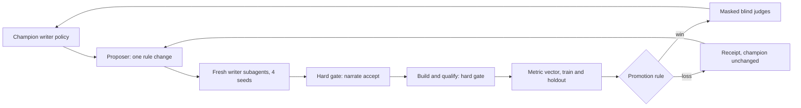

# Realism loop log

This file records the results, observations, and history of the BigLoom realism loop. The
instructions for the loop are in [`docs/self-improvement.md`](../self-improvement.md). Do not put
instructions here. Do not put results in the instructions file.

> [!IMPORTANT]
> This file holds holdout seeds and holdout numbers. The proposer must not read it. The proposer
> reads [`lessons.md`](lessons.md) and the train receipts only.

## Current state

Update this section at the end of each round and after each loop change.

| Item | Value |
|---|---|
| Updated | 26 Oct 2026 22:36 SGT (Round 32 rejected at build gate and on train `retail_per_k`) |
| Loop version | v3 (`judge_error` scored in `decide`, Level 2 one-sided distances, end picture page, and short slide titles merged in `7223e7c`) |
| Champion policy | `policies/writer/round-002.md` (`24fc8bdd…`, LF; was `a60c857a…` with two CRLF line ends) |
| Champion baseline receipt | `docs/realism/receipts/rescore-v2-031.json` (train view `docs/realism/loop/train-031r.json`) |
| Last round | Round 32, rejected (`gate_passed: false` on holdout `thin_pages`, train `retail_per_k` 0.943 worsened from 0.0, `top_opener_share` 0.032, `holdout_gain` -1.373, judges not called) |
| Next round number | 33 |
| Real files for the judges | `runs/realism/real/` (11 real files restored and verified against `docs/realism/reference-v2.json`) |
| Grader digest (v2) | `b1ff1f404a091754a90e18db3084b450d277481a6d1aee2128cafb2b2be1a647` |

### Open items

1. Run Round 33 against `rescore-v2-031.json` (`train-031r.json`).

### Level 2 change: one-sided defect distances, end picture page, and short slide titles (26 Oct 22:11 SGT)

- **Approval.** Approved by the monitor at 26 Oct 21:39 SGT after the 3-round plateau across Rounds 29, 30, and 31.
- **Cause.** First, `realism_loop.distances()` used two-sided `abs(vector[k] - real[k])` for all six `BANDS` dimensions, so any candidate with `top_opener_share` below the `0.055` champion (on the clean side below the `0.071` real median) was rejected as `worsened: ('top_opener_share',)` with a negative `holdout_gain`. Second, `pdf_add_picture` inserted the chart page at `len(reader.pages) // 2`, splitting wrapped sentences across the mid-document page break with `Figure: ...` in `P11`. Third, `worldloom.render.enterprise.presenter` generated 6-to-12-word takeaway slide titles that repeated the opening clause of the first bullet (`P04`, `P08`), and `pptx_add_evidence_slide` inserted the evidence slide at the middle of the deck.
- **Change (`7223e7c`).** `realism_loop.distances()` computes one-sided `max(0.0, round(float(vector[k]) - float(real[k]), 4))`. `pdf_add_picture` appends the chart page at the end of the PDF. `pptx_add_evidence_slide` appends the evidence slide at the end of the deck, and `filtered_longform()` wraps `presenter.takeaway`, `presenter.chart_takeaway`, `presenter.lint_titles`, and `pptx._Deck` slide/title/bullet helpers so slide titles and non-sentence lines are under six words.
- **Tests.** Five unit tests across `test_realism_loop.py`, `test_format_pdf.py`, `test_format_deck_workbook.py`, and `test_appendix_filter.py` failed on the old code (`5 failed`) and passed on the new code (`82 passed in 83.88s`).
- **Rescore (`docs/realism/receipts/rescore-v2-031.json`, `docs/realism/loop/train-031r.json`).** No writer runs. Both gates pass with zero violations (`train_vector`: `top_opener_share` `0.051`, `unique_sentences` `43.5`, all defect metrics `0.0`; `holdout_vector`: `top_opener_share` `0.047`, `retail_per_k` `0.37`, `cross_document_reuse` `0.054`). Six fresh judges (`9a6ebfae`, `c0330eda`, `9c21b064`, `630359d8`, `8e2a6dbf`, `2e0b2783`) scored `[20, 20, 20]` (`judge_error` `0.0`).

### Level 2 change: strip scaffold tables, running headers, and deck bullet truncation (26 Oct 20:08 SGT)

- **Approval.** Approved by the user at 26 Oct 19:16 SGT and the monitor at 26 Oct 19:40 SGT after the 3-round plateau across Rounds 26, 27, and 28.
- **Cause.** Ten of the 20 synthetic passages in `pairs.md` contained WorldLoom template scaffolding rather than writer prose: PDF `Document control`, `Revision history`, `Review record`, `Approval and sign-off form`, `Table 7.1: Prepared and reviewed` (`Approval`), `Appendix A Related documents`, mid-sentence PDF running headers/footers (`GTA/ENG/2026/007 | Version 1.0 | Approved`), DOCX cover subtitle/status lines, and PPTX `presenter._shorten` bullet truncations (`"Because the overall funding position..."`).
- **Change (`9666e84`, merged as `081df3c`).** `longform_filter.py` adds `"Related documents"` to `REMOVED_APPENDICES` and `"Approval"` to `REMOVED_IR_SECTIONS`, clears `subtitle`, `comments`, `revision.status`, and `history` status/summary in `filter_document`, and wraps `worldloom.render.enterprise.pdf` (`_distribution`, `_reference`, `_doc_class`) and `worldloom.render.enterprise.presenter._shorten` inside `filtered_longform()`.
- **Tests.** `test_review_record_keeps_one_row_for_each_comment_text` and `test_filter_strips_scaffold_tables_and_presenter_fragments` failed on the old code (`2 failed`) and passed on the new code (`18 passed in 75.01s`).
- **Rescore (`docs/realism/receipts/rescore-v2-028.json`, `docs/realism/loop/train-028r.json`).** No writer runs. Both gates pass with zero violations. Train `top_opener_share` improved from `0.064` to `0.055`, and every pair in `pairs.md` is now pure body prose. Six fresh judges (`67d14364`, `de9f6861`, `8714a058`, `3702631d`, `0c15001d`, `901d855b`) scored `[20, 20, 20]` on the `round-002.md` champion (`judge_error` `0.0`), citing only the reflective essay style of `round-002.md` prose rather than renderer scaffolding.

### Level 2 change: clear cover abstract and lowercase mid-sentence text facts (24 Oct 19:41 SGT)

- **Approval.** The user's standing instruction at 23 Oct 10:39 SGT and 24 Oct 15:18 SGT, confirmed by the monitor at 24 Oct 19:26 SGT after three consecutive rounds on `05fdb96` (Rounds 23, 24, and 25) did not promote.
- **Cause.** First, `worldloom.longform.document()` sets `LongDocument.abstract` to the opening paragraph of Section 1, which repeated two sentences on every PDF cover page (`within_file_repeat` floor) and caused `pdftotext` to stitch cover metadata onto Section 1's opening paragraph in `pairs.md`. Second, WorldLoom text-valued facts start with a capitalised regular word (`Stale...`, `Manual...`, `Overnight...`, `Asset...`, `One...`, `The...`, `A...`) that stayed capitalised when substituted mid-sentence after `[a-z,;:]\s+`.
- **Change (`557b742`, merged as `ce575de`).** `longform_filter.filter_document` clears `abstract=""`, and `_clean` lowercases the leading letter of text-valued facts from `text_fact_phrases(world)` when preceded by `[a-z,;:]\s+`.
- **Tests.** `test_filter_clears_abstract_and_lowercases_mid_sentence_text_facts` failed on the old code and passed on the new code (`17 passed in 78.91s`).
- **Rescore (`docs/realism/receipts/rescore-v2-025.json`, `docs/realism/loop/train-025r.json`).** No writer runs. Both gates pass. Train `within_file_repeat` fell from `0.024` to `0.0`, and holdout `within_file_repeat` fell from `0.028` to `0.0`. Six fresh judges (`7f411e81`, `cf4ab5b3`, `eab867f7`, `d0cb1041`, `2d5a5feb`, `5b415dea`) scored `[20, 20, 20]` on train and holdout (`judge_error` `0.0`).

### Level 2 change: PPTX passage deduplication, trap chart caption, and `gate_passed` guard (24 Oct 16:45 SGT)

- **Approval.** The user's standing instruction at 23 Oct 10:39 SGT and 24 Oct 15:18 SGT, confirmed by the monitor at 24 Oct 16:37 SGT after a 3-round retrieval gate plateau (Rounds 17, 18, and 19 all failed `*-image: target_or_trap_not_in_top3`).
- **Cause.** First, `inspect_artifact` emits `slide:<n>/hidden` (`"false"`), `slide:<n>/shape:<m>/text`, and `slide:<n>/text` (which concatenates all shapes on the slide). `qualify._reader_units` kept both `shape:<m>/text` and `slide:<n>/text`, so every word on every PPTX slide was counted twice in `passages_of`. Second, `PptxHandler.finish_trap` and all three `finish_target` handlers included `t.caption` (`Figure: <chart_title>. Bars: ...`), whereas `FormatHandler.canary_ir` (used by DOCX and PDF traps) omitted `t.caption`.
- **Change (`894a26a`, merged as `efddbb4`).** `qualify._reader_units` drops `/hidden` and `slide:<n>/text` summary units. `FormatHandler.canary_ir` includes `t.caption` in the planted canary table row label. `realism_loop.decide` accepts `gate_passed: bool = True` and adds `"build or fact gate failed"` to `reasons` when `not gate_passed`. `realism_metrics.py` is untouched (`b1ff1f40…`), and `rs017d` target files are unchanged.
- **Tests.** `test_pptx_passages_count_each_slide_line_once_and_drop_hidden_flag`, `test_canary_ir_includes_chart_caption_for_trap_retrieval`, and `test_decide_rejects_when_gate_fails` all failed on the old code and passed on the new code. Full suite: 182 passed in 332.21s.

### Level 2 change: judge error rate as a scored metric, grader v3 (rule recorded 24 Oct 15:14 SGT, before code or measure)

- **Approval.** The user at 24 Oct 15:12 SGT: "yes" to the judge error rate as a scored metric, and
  "dont stop".
- **Definition.** `judge_error = 1 - correct / (20 x 3)` for one set: 3 fresh masked judges, 20 pairs
  each. Real target 0.5 (the judges cannot tell). Distance `|judge_error - 0.5|`. Band 0.10 (6 of 60
  verdicts).
- **In `decide`.** `judge_error` is one more dimension in the train improved and worsened checks
  and in the holdout normalised gain. The old judge guard is removed: a worse `judge_error` beyond
  its band now blocks as "worsened". A side without judge counts skips the dimension.
- **When.** Judges run on the train set and the holdout set of every candidate that passes the fact
  gate and the build gate.
- **Pair seed.** One seed for each baseline, used for the champion and every candidate until the
  champion changes: `18000 + baseline round number` (rs017d: 18017). Real set: `runs/realism/real`.
- **Champion.** Judged once for each baseline, on train and holdout.
- **Cost for each round.** 4 writer runs and 6 judge runs. Baseline now: 6 judge runs.
- **Noise check (monitor, 24 Oct 15:14 SGT).** Before any round, judge the rs017d champion train set
  twice, with two independent groups of 3 fresh judges on the same pairs (seed 18017). If the two
  `judge_error` values differ by more than 0.10, the metric is too noisy to promote on: stop and
  report, and do not start Round 17. Cost: 3 more judge runs, one time.
- **Tests.** A candidate with the same vector and judge error 0.0 to 0.5 promotes. A candidate
  whose judge error moves away from 0.5 by more than 0.10 is blocked as "worsened".
- **Barrier.** Holdout judge verdicts and holdout clues never go to `lessons.md`, `train-*.json`,
  or any proposer input. Train clues only.

### Level 2 change: public-sector measure words in WorldLoom template text (23 Oct 21:15 SGT)

- **Approval.** The user's standing instruction at 23 Oct 10:39 SGT, confirmed by the monitor at
  20:54 SGT.
- **Cause.** The 3101 executive summary deck held all holdout commercial phrases. The deck renderer
  titles slides from `composer.measure_noun` ("gross profit") and quotes the template prose of
  other pack documents ("Gross profit landed at SGD 5.1m").
- **Change (`dccb948`).** For a public-sector pack, the render pass wraps `measure_noun` and renames
  "gross profit" and "gross margin" in template prose, headings, titles, and chart titles. Agent
  prose (documents in the narration plan) stays as written, so `commercial_per_k` still sees the
  writer's words. The monitor asked for this limit.
- **Tests.** `test_rendered_decks_use_public_sector_measure_words` fails on the old code and passes
  on the new code. `test_agent_prose_keeps_its_commercial_words` shows that a writer section keeps
  "gross profit". Full suite passed.
- **Rescore (`docs/realism/receipts/rescore-v2-017d.json`).** No writer runs. Both gates pass.
  Holdout `commercial_per_k` 2.08 to 0.00. No commercial phrase remains in any file, so no agent body
  holds one.

### Level 2 change: records, not SKUs (23 Oct 21:04 SGT)

- **Approval.** The user's standing instruction at 23 Oct 10:39 SGT, confirmed by the monitor at
  20:54 SGT.
- **Cause.** The govtech pack runs on the WorldLoom retail engine. The fact `ops.affected_records`
  has the unit `SKUs`, so every incident document said "22,859 SKUs". It made the whole train
  `retail_per_k` floor (0.60).
- **Change (`ea3f1da`).** `build.public_units` spells the unit as "records" in the render pass of a
  public-sector pack. Amounts, ids, the corpus on disk, and the writer requests do not change.
- **Tests.** `test_rendered_documents_hold_no_skus` fails on the old code ("'SKU' is contained
  here") and passes on the new code. Full suite passed.
- **Rescore (`docs/realism/receipts/rescore-v2-017c.json`).** No writer runs. Both gates pass. Train
  `retail_per_k` 0.60 to 0.00. Holdout `retail_per_k` 0.77 to 0.35. The rest is one appendix title
  "Store Performance (SGD thousands)" in the 3101 executive summary deck (a WorldLoom workbook sheet).

### Level 2 change (proposed): `reader_directed_per_k`, grader v3 (pattern recorded 23 Oct 20:52 SGT, before any real-file measure)

- **Approval.** The user's standing instruction at 23 Oct 10:39 SGT, confirmed by the monitor at
  20:52 SGT.
- **Cause.** In the rs016 and rescore-v2-017 judge runs (train passages only), the judges named
  prose that tells the reader or a named role what to conclude or do: "Readers deciding whether to
  wait should...", "For engineers, the lesson is...", advice to "the cluster finance partner".
- **Pattern (fixed now, not tuned after the measure).** A sentence counts when it names a reader or
  a role and also gives a direction:
  - Reader or role: `readers?`, `you`, `engineers`, `management`, `leadership`, `service owners?`,
    or `the` + one of `committee`, `board`, `cluster head`, `cluster finance partner`,
    `finance lead`, `finance partner`, `controller`, `reader`, `executive committee`.
  - Direction: `should`, `must`, `needs? to`, `(is|are) asked to`, `will want to`, `ought to`,
    `the lesson`, `what this means`, `the point (for|is)`.
  - The rate is counted sentences per 1000 words, like the other `_per_k` metrics.
- **Stop rule.** If the real median is not clearly below the champion train value, stop and report.
- **Measure (23 Oct 20:52 SGT, pattern unchanged).** Real median 0.00 per 1000 words (9 of 11 real
  files have 0; the DPO guide has 3 sentences, the SGTS page 1). Champion rescore-v2-017 train mean
  1.18: only 3 sentences in 6 files (1 in the 2 MB DOCX, 2 in the 2 MB deck, where a short file makes
  2 sentences worth 5.67). Holdout mean 1.64 (8 sentences).
- **Result: stopped, not adopted.** The gap rests on 3 train sentences. One sentence in a short deck
  moves the mean by about 0.9, so a sensible band is about 1.0, and the room after the band is
  about 0.2. The pattern also misses most of the lines that the judges quoted, because they give no
  modal verb ("For engineers, the lesson is..." is caught, "Six months from now..." is not). The
  metric is too sparse and too noisy for a grader change. The grader stays at v2 (`b1ff1f40...`).

### rescore-v2-017: champion on the target family rule (23 Oct 20:50 SGT)

Receipt: `docs/realism/receipts/rescore-v2-017.json`. Fresh writers on `round-002.md`. All four seeds
passed the fact gate on the first orchestrator run. Both build gates pass, including the 570-word
service impact assessment. New reference: do not compare with rs016 as a gain or a loss.

| Metric | Train | Holdout | Real median | Floor (train) | Room after floor |
|---|---|---|---|---|---|
| `commercial_per_k` | 0.00 | 2.08 | 0.0 | 0 | No |
| `retail_per_k` | 0.60 | 0.77 | 0.0 | 0.60 | No |
| `within_file_repeat` | 2.4% | 2.8% | 0.0% | 2.4% | No |
| `top_opener_share` | 5.9% | 5.1% | 7.1% | 0 | No (clean side of the real median) |
| `cross_document_reuse` | 0.0% | 3.6% | 0.1% | 0 | No |

- **Targets.** Train: DOCX service impact assessment, PDF incident review, PPTX Exco update. Holdout
  3101: incident review, budget report, executive summary. Holdout 3102: same as train.
- **New floor.** `retail_per_k` 0.60 comes from one fact value that renders as "22,859 SKUs"
  (WorldLoom ledger unit). A writer must cite it.
- **Known limits.** The 3101 executive summary deck has 220 words of agent prose, and its slide
  titles come from WorldLoom templates that say "gross profit" (holdout `commercial_per_k` 2.08).
  The 3102 writer reused sentences across its own documents (holdout reuse 3.6%).
- **Cost.** Agent prose for each seed fell from about 5,750 to about 3,650 words. The DOCX service
  impact assessment holds about 720 words.
- **Length guard reference from now:** 2026: 3,484, 2027: 3,518, 3101: 3,230, 3102: 3,103.

### Level 2 change: target selection prefers a new family (recorded 23 Oct 20:25 SGT, before the baseline)

- **Approval.** The user's standing instruction at 23 Oct 10:39 SGT, confirmed by the monitor at
  20:22 SGT. The user did not choose between option A and option B by name.
- **Cause.** The rs016 judges saw only two synthetic families (budget report, incident review). The
  old targets were the documents with the most prose, which were all finance documents and one
  incident review.
- **Rule.** In `narration.choose_candidates` and `build._choose`: first a document from a family
  (WorldLoom filing domain) that no earlier target uses, then a preferred type, then the most
  prose. One rule in two functions.
- **Preference list (fixed now, not tuned after judge results):** `service_impact_assessment` only.
  Reason: the real set (file names only) holds 5 service standards. It is the operations type that
  renders as DOCX or PDF with the longest brief (570 words, 3 sections, seed 2026).
- **Left out:** `knowledge_article` (380 words, 2 sections on seed 2026), which is thin for a 2 MB or
  5 MB file and may fail the fact-depth or retrieval gate.
- **Gates.** If a new target fails a gate, report it. Do not lower a gate.
- **Baseline.** The new baseline is `rescore-v2-017`. It is a new reference. Do not compare its
  vector with rs016 as a gain or a loss.
- **Correction after the first cache (`15f94d1`).** The first version filled the five candidate
  slots by family alone, so the PPTX deck lost its agent prose and `knowledge_article` entered on
  seed 3101. The fix picks one candidate for each format in the build order with the build's
  ranking, then the spares, and excludes `knowledge_article` by name. The first symptom was seen on
  holdout seed 3101. The fix rests on the general cause (slots filled by family, not by format), so
  the monitor accepted it. After this change, no selection change may rest on a holdout output.
- **Candidates on the rebuilt cache (23 Oct 20:40 SGT).** Seeds 2026, 2027, 3102:
  `service_impact_assessment` 570, `incident_rca` 1500, `exco_update` 950,
  `audit_observations_response` 380, `executive_summary` 220 (3,620 words). Expected targets: DOCX
  service impact assessment (operations), PDF incident review (engineering), PPTX Exco update
  (finance). Seed 3101 has no service impact assessment: `incident_rca` 1500,
  `budget_utilisation_report` 1200, `executive_summary` 220, `audit_observations_response` 380,
  `data_quality_review` 380 (3,680 words). Expected targets: DOCX incident review, PDF budget report,
  PPTX executive summary. **Known limit:** the 3101 PPTX target has only 220 words of agent prose.
  No special case is added for it.

### Level 2 change: related documents table (23 Oct 20:19 SGT)

- **Approval.** The user's standing instruction at 23 Oct 10:39 SGT ("keep going. dont stop. I will
  go with your recommendations."), confirmed by the monitor at 20:10 SGT.
- **Cause.** The rs016 judges reported one table cell repeated across four columns. It was the
  "Related documents" appendix: WorldLoom gives type and role the same words, and BigLoom replaced
  the ID label with the title, so a row read "Board Paper | Board Paper | Board paper | Board paper".
- **Change (`ec00450`).** The label is a readable reference (`GTA/FIN/2026/019`). Only the related
  documents table drops a column that copies an earlier one. Figure tables keep every column.
- **Tests.** The related table test fails on the old code with
  `assert ['title', 'type', 'role'] == ['title', 'type']`. A guard test keeps a budget and an actual
  column with the same value. Full suite passed.
- **Rescore (`docs/realism/receipts/rescore-v2-016b.json`).** No writer runs. Both gates pass. The
  vector does not change (table rows hold no sentence of six words or more). The table now reads
  "Reference | Title".

### rs016 champion baseline on the new requests (23 Oct 20:05 SGT)

Receipt: `docs/realism/receipts/rescore-v2-016.json`. Champion policy `round-002.md`, fresh writers,
new requests (`4a708a6`). Both gates pass. The length guard reference for Round 16 and later is the
rs016 `agent_words`: 2026: 4,109, 2027: 3,238, 3101: 5,196, 3102: 5,225. Seed 2027 used attempt 2
(attempt 1 had 4,375 words and is kept in `runs/loop/rs016-attempts/`).

| Metric | Train | Holdout | Real median | Band | Train room |
|---|---|---|---|---|---|
| `commercial_per_k` | 0.00 | 0.00 | 0.0 | 0.5 | No |
| `retail_per_k` | 0.24 | 0.20 | 0.0 | 0.3 | No |
| `within_file_repeat` | 3.8% | 2.7% | 0.0% | 1 point | No, the floor is 3.8% |
| `top_opener_share` | 6.2% | 5.7% | 7.1% | 1 point | No |
| `cross_document_reuse` | 0.0% | 0.0% | 0.1% | 1 point | No |

The request terminology change worked: holdout `commercial_per_k` fell from 4.35 to 0.00, and train
from 0.18 to 0.00. All remaining train `within_file_repeat` comes from the PDF cover Summary box
(6 of 58 and 6 of 48 sentences). The box copies the first 90 words, so shorter sentences raise
this floor.

### Champion rescore on v2 code (23 Oct 10:50 SGT)

Receipt: `docs/realism/receipts/rescore-v2-002.json`. Round 2 prose, rebuilt on `65955eb`, no new
writer runs. Both gates pass.

| Metric | Train | Holdout | Real median | Band | Train room |
|---|---|---|---|---|---|
| `commercial_per_k` | 0.18 | 4.35 | 0.0 | 0.5 | No |
| `retail_per_k` | 0.21 | 0.23 | 0.0 | 0.3 | No |
| `within_file_repeat` | 2.5% | 2.6% | 0.0% | 1 point | No, the floor is 2.6% |
| `top_opener_share` | 6.1% | 4.3% | 7.1% | 1 point | No |
| `cross_document_reuse` | 0.0% | 0.0% | 0.1% | 1 point | No |

The `within_file_repeat` floor comes from the PDF cover Summary box: 4 of 64 sentences in the 2 MB
PDF and 6 of 66 in the 5 MB PDF. The train mean floor is 2.6%. The train pair shows almost no
commercial phrases (0.18), but the holdout pair shows 4.35. The train seeds do not show the problem
that remains.

### Level 2 change: public-sector terms in the writer requests (23 Oct 11:10 SGT)

- **Approval.** The user's standing instruction at 23 Oct 10:39 SGT: "keep going. dont stop. I will
  go with your recommendations." The user did not approve this change by name.
- **Cause.** Every `requests.json` named "profit" about 73 times and "surplus" never. The words come
  from the fact labels, which WorldLoom builds from ledger keys (`financial.gross_profit.actual`).
  Writer variance then decided how many commercial phrases a file held (train 0.18, holdout 4.35).
- **Change.** `narration.public_terms` (commit `4a708a6`) adds a `terminology` entry to each request
  whose facts measure gross profit or gross margin, for a public-sector pack only. The entry names
  "gross surplus" and "surplus rate", the same words that BigLoom plants. Fact keys and values do
  not change.
- **Corpus, not policy.** The entry is part of the requests for the champion and for every
  candidate. It is not a policy rule.
- **Test.** `test_public_sector_requests_name_a_surplus` passes on `4a708a6` and fails on `baf748a`
  with `KeyError: 'gross_profit'`. `narrate accept` still accepts the old Round 2 prose against the
  new requests (21 of 21). Full suite: 168 passed.
- **Cache.** The old cache is in `runs/loop/cache-backup-20261023-1110`. The new cache holds the new
  requests for seeds 2026, 2027, 3101, and 3102.
- **Effect.** Not measured yet. The champion prose must be written again on the new requests.
- **Build gate risk (checked 23 Oct 11:12 SGT).** In v1, prose without the word "margin" made the
  DOCX chart query fail the retrieval gate, because "margin" became rare (Rounds 9, 10, 12). In the
  rebuilt v2 cache, no planted label, chart title, or eval question holds "margin" or "profit".
  They name "surplus" (117 to 120 times for each seed). The v1 failure path does not apply. The new
  requests make "surplus" common in the prose, which lowers its BM25 weight. The chart titles then
  differ by their last words ("by business unit", "by category", "by site"). The build gate of the
  rescore will confirm this. No code change is made for this risk.

## History of the loop design (v1)

The text below describes loop v1 as it ran in Rounds 0 to 15.

## 1. The loop

Each round has six steps:

1. **Proposal.** The proposer subagent reads the train receipts. It writes
   `policies/writer/round-<NNN>.md`, which is the champion policy with one rule changed.
2. **Writing.** Four fresh writer subagents answer the WorldLoom narration requests. Each one sees
   only the text of the candidate policy. Two seeds are train (`2026` at 2 MB, `2027` at 5 MB). Two
   seeds are holdout (`3101` at 2 MB, `3102` at 5 MB).
3. **Fact gate.** `bigloom narrate accept` runs the WorldLoom claim checks. A section with an
   unsupported claim, a typed digit, or an invented entity fails.
4. **Build gate.** `bigloom qualify` builds the files and checks leakage, fact depth, and retrieval.
   The retrieval check requires the target file to rank in the BM25 and TF-IDF top 3 for its query.
5. **Score.** `realism_metrics` measures the metric vector on train and on holdout (section 2).
6. **Decision.** `realism_loop.decide` applies the promotion rule. A promoted candidate then goes to
   three masked blind judges (section 4).

### Promotion rule

A candidate is promoted only when all four conditions are true:

- On train, at least one metric moves closer to the real value by more than its band.
- On train, no metric moves away from the real value by more than its band.
- On holdout, the summed normalised distance to the real values falls.
- The judge guard does not trip.

| Metric | Band |
|---|---|
| `commercial_per_k` | 0.5 |
| `retail_per_k` | 0.3 |
| `wl_id_per_k` | 0.5 |
| `within_file_repeat` | 0.01 |
| `top_opener_share` | 0.01 |
| `unique_sentences` | 5.0 |
| `cross_document_reuse` | 0.01 |

### Rules that do not change

- **Frozen grader.** Each receipt records `grader_sha256`
  (`eeb607b3b32acbfc02a99f24c97da73e0a94d871c1272b4d2e456b66f56dd32b`). The loop stops if the grader
  changes.
- **One change in each round.** A candidate changes one rule of the champion and nothing else.
- **Holdout isolation.** The proposer never sees holdout numbers, holdout seeds, or holdout passages.
- **Fresh writers.** Each round uses new writer subagents. A writer never sees an earlier round's
  `responses.json`.
- **Masked judges.** Product and organisation names are masked (`[PRODUCT-1]`, `[ORG-1]`) on both
  sides of every judge pair.
- **No Vertex AI.** Every model role is a Jetski subagent.

## 2. What the metrics measure, and their limits

The metric vector uses no model calls. Rates are per 1000 words. The real reference comes from 11
real agency files.

| Metric | What it counts | Real value |
|---|---|---|
| `commercial_per_k` | The phrases `gross profit`, `gross margin`, `operating margin`, `EBITDA`, `sales volume` | 0.0 |
| `retail_per_k` | Retail words such as `store`, `SKU`, `footfall` | 0.78 |
| `wl_id_per_k` | WorldLoom ledger IDs such as `FACT-0028` | 0.0 |
| `within_file_repeat` | The share of sentences that repeat in one file | 4.0% |
| `top_opener_share` | The share of sentences that start with the most common three-word opener | 7.4% |
| `unique_sentences` | Distinct sentences in each file | 146.7 |
| `cross_document_reuse` | The share of sentences that also occur in a different document | 0.1% |

Three properties of the corpus limit what a writer policy can change.

**The `commercial_per_k` floor.** The planted chart captions and tables hold fixed commercial
phrases: one in each DOCX, six in each PDF, and one in each PPTX. With zero commercial phrases in the
prose, train `commercial_per_k` is still about 2.0. The champion is at 2.26. Thus this metric cannot
improve by more than its 0.5 band. A promotion must come from `unique_sentences` or
`top_opener_share`.

**PPTX slide footers.** The PPTX renderer makes one slide bullet from each paragraph. Each slide also
has a date footer, which the metric reads as a sentence that starts with `# April #`. A deck has five
such footers. With three paragraphs in each section, a deck has about 16 sentences and the footers
make 31% of the openers. With two paragraphs, a deck has about 10 sentences and the footers make 50%.
Thus fewer paragraphs raise `top_opener_share`, even when the prose is varied.

**BM25 and the word `margin`.** The DOCX image query asks about the chart "Revised gross margin
forecast by business unit". When the PDF and PPTX prose do not use the word `margin`, its BM25 weight
rises. Then a PPTX, whose chart caption holds `margin`, can rank above the target DOCX, and the
retrieval gate fails. This caused the gate failures in Rounds 9, 10, and 12. The single word `margin`
does not count in `commercial_per_k`. Only the two-word phrases count.

## 3. Measured results

The champion is `policies/writer/round-002.md`
(`a60c857a9f108744c69896cf49cd8a56be5a322e8da5729f1d2d2ec5ee6f5b98`).

| Metric | Real | Round 0 train (template writer) | Round 1 train (first writer policy) | Champion train |
|---|---|---|---|---|
| `wl_id_per_k` | 0.0 | 20.50 | 0.00 | 0.00 |
| `commercial_per_k` | 0.0 | 20.44 | 7.55 | 2.26 |
| `retail_per_k` | 0.78 | 1.40 | 0.21 | 0.21 |
| `within_file_repeat` | 4.0% | 16.0% | 4.4% | 3.9% |
| `top_opener_share` | 7.4% | 20.1% | 12.0% | 13.0% |
| `unique_sentences` | 146.7 | 30.5 | 51.3 | 48.8 |
| `cross_document_reuse` | 0.1% | 6.6% | 0.0% | 0.0% |
| Words per MB | 4,032 | 443 | 440 | 435 |

The champion holdout values are in section 7.

Most of the gain came before the loop started. The handshake writer and the appendix filter (Round 1)
removed the ledger IDs and the reused template sentences. Round 2 then cut train `commercial_per_k`
from 7.55 to 2.26.

Rounds 3 to 14 did not promote a change. Eight of the twelve candidates passed the hard gates on
both sets. Several candidates gained on holdout. Each one still lost on train, because a second metric got
worse by more than its band.

The files are still far from real on two metrics. Real files have about three times as many distinct
sentences (146.7 against 48.8). Their text is also about nine times more dense (4,032 words per MB
against 435). The masked judges can still tell real from synthetic every time (section 4).

## 4. Blind judges

Three judges each see 20 pairs. Each pair holds one real passage and one synthetic passage, with
names masked. A judge error rate of 50% means the judges cannot tell the two sides apart.

| Round | Correct verdicts | Mean error | Main clues the judges gave |
|---|---|---|---|
| Round 0 (unmasked) | 60 of 60 | 0% | WorldLoom IDs, lineage tables, template phrases |
| Round 1 (unmasked) | 60 of 60 | 0% | Real product and framework names on the real side |
| Round 1 (masked) | 20 of 60 | 67% | Each judge sorted the pairs into two series, and two judges reversed which series was real |
| Round 2 (masked) | 60 of 60 | 0% | PDF extraction marks on the real side, polished narrative tone on the synthetic side |
| Round 11 (masked) | 60 of 60 | 0% | Real external standards and `.gov.sg` domains on the real side, capital letters in mid-sentence fact splices on the synthetic side |

A judge gives one label to a whole document series, so its 20 verdicts are not independent. The judge
guard therefore blocks a promotion only when every judge does better on the candidate and the mean
error falls by more than `JUDGE_BAND` (0.10).

Most judge clues are about the real side (extraction marks, real standards). The prose rules cannot
change those clues.

## 5. What we learned

**Holdout exposure in loop v1 (found 23 Oct 10:50 SGT).** In loop v1 the proposer could read data
from the holdout seeds by two paths. First, `policies/PROPOSER.md` allowed
`docs/realism/receipts/round*.json`, which hold the holdout vector and the holdout gain (closed in
`c25eeb1`). Second, `docs/realism/loop/train-*.json` held holdout seed keys (`seed_3101`,
`seed_3102`) with word counts in Rounds 4, 11, 14, and 15, a `decision` field with the holdout gain,
and writer notes with holdout numbers in Rounds 4, 5, 6, 8, 11, 13, 14, and 15. These were removed
from all train receipts before any v2 proposer ran. No one can prove that the v1 proposer did not
read them. Thus the v1 holdout results for Rounds 3 to 15 are not fully independent. No v1 round
was promoted after Round 2, so the champion is not affected.

**One rule change moves two metrics in opposite directions.** Shorter sentences raise
`unique_sentences`, but writers then name `gross profit` once in each new paragraph (Rounds 5, 8,
14). Fewer commercial words lower `commercial_per_k`, but writers then join facts into long compound
sentences of 25 to 30 words, which lowers `unique_sentences` (Rounds 4, 11, 13). Each fix to one metric
made the other metric worse.

**One run for each seed is a noisy test.** Under the same policy, two fresh writers wrote 0 and 32
commercial phrases (Round 5 and Round 8, seeds 2026 and 2027). In Round 7 and Round 11, fresh writers
wrote half the target length. A single run cannot tell a policy effect from writer variance. WorldLoom
found the same problem in its first live pilot.

**The real limits are in the corpus, not in the policy.** The `commercial_per_k` floor, the PPTX
footers, and the BM25 effect (section 2) each come from the planted content or the renderer. The
proposer can only change the writer policy, so it cannot remove them.

**Near misses are discarded.** Rounds 5, 8, 9, and 12 each gained on holdout and improved one or two
train metrics. The loop keeps no archive, so later rounds start again from the champion and cannot
build on these candidates.

**Process errors invalidate a round.** The supervisor stopped four errors: two rules in one round, a
receipt with passages from an earlier round, holdout numbers in a proposer message, and writers
told to copy earlier output. Each affected round ran again from scratch. The rules in section 1 now
prevent these errors.

**An empty field is a silent error.** The first Round 15 receipt had no sample passages. The sample
extractor read `runs/loop/r015t/set`, but the files are in `set/large`. The extractor returned an
empty list and no error. Commit `1ab566a` added the two passages. The receipt checklist in
`docs/self-improvement.md` now catches this error before a commit.

**Possible holdout leak in v1.** In Rounds 3 to 15, `policies/PROPOSER.md` let the proposer read
`docs/realism/receipts/round*.json`. Those receipts hold holdout vectors and holdout gains. Nobody can
show whether a proposer read them. Treat the holdout results of Rounds 3 to 15 as possibly not
clean. Round 2, the champion, is not affected. Commit `c25eeb1` closed this path.

## 6. Levers listed after loop v1

The instructions file holds the current order of design changes.

1. **Repeat runs.** Run two writers on each seed and compare the means. This reduces writer variance.
2. **An archive of near misses.** Keep candidates that gained on holdout, and let the proposer start
   from one of them.
3. **A floor-aware band.** Measure `commercial_per_k` on the prose only, or subtract the fixed
   phrases from the planted content.
4. **Fixes in the corpus.** Write the PPTX date footer so that it is not read as a sentence, and keep
   the word `margin` in the PDF so that the BM25 weight does not change.
5. **Round 15 result.** Round 15 raised train `unique_sentences` from 48.8 to 74.3 and gained `+4.119`
   on holdout. It was rejected because train `commercial_per_k` rose from 2.26 to 6.47. Shorter
   sentences again made writers name `gross profit` in more paragraphs.

## 7. Loop v2: observations

Recorded by the loop monitor, 23 Oct 2026 10:45 SGT.

### Holdout set

The holdout seeds are `3101` (2 MB) and `3102` (5 MB). Loop v1 champion holdout (grader v1):
`wl_id_per_k` 0.00, `commercial_per_k` 6.30, `retail_per_k` 0.23, `within_file_repeat` 4.0%,
`top_opener_share` 13.5%, `unique_sentences` 52.0, `cross_document_reuse` 0.0%, words per MB 390.

### What changed in loop v2

| Item | Loop v1 | Loop v2 |
|---|---|---|
| Grader digest | `eeb607b3…` | `b1ff1f40…` (skips PPTX date, footer, and slide number text) |
| Planted nouns in a public-sector pack | `gross profit`, `gross margin` | `gross surplus`, `surplus rate` |
| Real reference | Mean of 11 real files | Median of 11 real files (`docs/realism/reference-v2.json`) |
| `unique_sentences` in the promotion rule | Scored, band 5.0 | Not scored. Receipts report it only. User approved, 23 Oct 10:39 SGT. |

A v1 receipt and a v2 receipt use different graders. Do not compare their numbers directly. To compare
a v1 policy with a v2 policy, rebuild the v1 prose on v2 code and score it again. A rescore is not a
new round. Label it as a rescore in the receipt.

### The v2 vector has little room on train

The v2 champion rescore (train, grader v2) shows how much each metric can still gain:

| Metric | Real median | Champion train | Can it gain more than its band? |
|---|---|---|---|
| `commercial_per_k` | 0.0 | 0.17 | No. The gap (0.17) is less than the band (0.5). |
| `retail_per_k` | 0.0 | 0.21 | No. The gap (0.21) is less than the band (0.3). |
| `top_opener_share` | 7.1% | 6.3% | No. The gap (0.8 points) is less than the band (1 point). |
| `within_file_repeat` | 0.0% | 3.9% | Not through the writer. See the next paragraph. |
| `cross_document_reuse` | 0.1% | 0.0% | No. |

The champion repeats come from the PDF only. The DOCX and PPTX files have no repeated sentence. The
PDF repeats have two sources, and neither source is the writer policy:

- The review record table. WorldLoom gives one reviewer comment to several sections, so the same
  comment occurs three times in each PDF.
- The cover abstract. It copies sentences from the first executive summary paragraph.

Thus no metric in the v2 vector can promote a writer policy on train at the moment. The other
metrics can only block a candidate. Do not tell the proposer to target repeated sentences. First fix
the two sources in BigLoom, rebuild the champion, and measure it again. If the vector still has no
room after that, the loop needs a new signal.

**Source (a), the review record.** The worker removes repeated reviewer comments in
`longform_filter` on `realism-v2`. The new test
`test_review_record_keeps_one_row_for_each_comment_text` fails on the old code (`assert 4 == 1`) and
passes on v2.

**Source (b), the cover abstract.** The worker keeps the cover summary box. This is a design choice,
not a realism claim. The real files have a median `within_file_repeat` of 0.0%, so they do not show
this repeat. The box repeats 2 to 3 sentences in each PDF. Each v2 receipt records this count as a
known floor for `within_file_repeat`.

### Train and holdout do not agree

On v2, champion train `commercial_per_k` is 0.17, but champion holdout is 4.31. The train seeds do
not show the commercial phrase problem, so the proposer cannot see it. Round 15 under v2 shows the
same gap: train 4.48, holdout 3.90. The writer, not the policy, causes most of this variance (section
5).

## Appendix A. Rounds

The receipt for each row is `docs/realism/receipts/round<N>.json`. It holds the full vectors, the
samples, and the policy digest.

| Round | Change under test | Result | Main reason |
|---|---|---|---|
| 0 | WorldLoom template writer | Baseline | Not applicable |
| 1 | Handshake writer, appendix and ID filter, single-column measure table (`bda2a5cd…`) | Baseline champion | Not applicable |
| 2 | `VOCABULARY`: name commercial measures at most once in a paragraph (`a60c857a…`) | **Promoted** | `commercial_per_k` 7.55 to 2.26 on train |
| 3 | Opener cap and thin-fact procedure rule (`b739d290…`) | Rejected | Two rules in one round. Retrieval gate failed. |
| 4 | Each commercial word once in each section (`b10737ef…`) | Rejected | `unique_sentences` 48.8 to 35.3 |
| 5 | Sentences of 12 to 18 words (`69b1350e…`) | Rejected | `commercial_per_k` 2.26 to 4.78 |
| 6 | Opener cap of two in each document (`41278114…`) | Rejected | A reused writer carried Round 5 text |
| 7 | Each commercial measure once in each section, fresh writers (`5fd47221…`) | Rejected | Writers wrote half length, `unique_sentences` 29.2 |
| 8 | Word and sentence floor in each section (`8c9f8b23…`) | Rejected | `commercial_per_k` 2.26 to 4.09 |
| 9 | Commercial words once in each document (`e940cc6a…`) | Rejected | Retrieval gate failed (BM25 effect) |
| 10 | `gross margin` once in each section of one document (`db8c8714…`) | Rejected | Retrieval gate failed (BM25 effect) |
| 11 | `gross margin` in three named sections (`75139cfa…`) | Rejected | Wrong section names, `unique_sentences` 31.2 |
| 12 | Sentences of 12 to 16 words (`8e383634…`) | Rejected | Retrieval gate failed on one seed |
| 13 | `gross margin` in four named sections (`1bb77be6…`) | Rejected | `unique_sentences` 48.8 to 38.5 |
| 14 | Two paragraphs of short sentences in each section (`89a09a12…`) | Rejected | `commercial_per_k` 3.48, PPTX footers raised `top_opener_share` to 16.6% |
| 15 | Short sentences of 13 to 17 words in three paragraphs (`57dae3c7…`) | Rejected | `unique_sentences` 48.8 to 74.3, but `commercial_per_k` 2.26 to 6.47 |
| 17 | Replace `"Lead with the position, group related facts, say what they mean"` with `"Use a flat record tone that states facts and actions without essay commentary or reader advice"` (`f78fe8f8…`) | Rejected | Train length guard failed on `seed_2027` (2631 and 2553 words vs 2815 threshold); retrieval gate failed on train (`bl-002-pdf-5mb-image`) and holdout (`bl-001-docx-2mb-image`); train `retail_per_k` 0.0 to 0.705 |
| 18 | Add `"Expand each point with concrete system workflows, control checks, and operational steps instead of essay commentary or reader advice"` (`2aee9ca5…`) | Rejected | Retrieval gate failed on train (`bl-001-docx-2mb-image`, `bl-002-pdf-2mb-image`) and holdout (`bl-001-docx-2mb-image`); train `retail_per_k` 0.0 to 0.453 (`store`/`stores`) and `top_opener_share` 0.059 to 0.044 |
| 19 | Replace `"say what they mean"` with `"and state their effect on divisions and registers without commentary or reader advice"` (`e192e4b1…`) | Rejected | Train `within_file_repeat` improved 0.024 to 0.013 with zero worsened dimensions and `holdout_gain` +3.48, but `bl-002-pdf-5mb-image` failed `target_or_trap_not_in_top3` |
| 20 | Re-test Round 19 rule (`e192e4b1…`) after Level 2 retrieval fix | Rejected | Train passed all gates and improved `within_file_repeat` 0.024 to 0.013 with zero worsened dimensions (`judge_correct_train` `[20, 20, 20]`) and `holdout_gain` +3.163, but holdout `3101` failed `bl-001-docx-2mb-image: target_or_trap_not_in_top3` |
| 21 | Add `"Place every capitalised text fact at the start of a sentence or after a colon."` (`1ec8d4a2…`) | Rejected | Both train and holdout passed all build and retrieval gates (`holdout_gain` +3.097), but `seed_2026` failed the 80% length guard on both attempts (2554 and 2377 words vs 2787.2 threshold) |
| 22 | Replace `"say what they mean"` with `"and explain their operational effect on programme delivery and budgets without essay commentary or reader advice"` (`7ff40674…`) | Rejected | Train passed all gates and improved `within_file_repeat` 0.024 to 0.013 with zero worsened dimensions (`judge_correct_train` `[20, 20, 20]`) and `holdout_gain` +1.573 (`commercial_per_k` 0.0 on holdout), but holdout `3101` failed `bl-001-docx-2mb-image: target_or_trap_not_in_top3` |
| L2 (after 22) | `docx_add_picture` matches the evidence table from `reversed(doc.tables)` and adds the figure caption row to the evidence table (`05fdb96`, `rescore-v2-022.json`) | Rescore | Restores target-trap table passage symmetry on DOCX (`rs017dt`, `rs017dh`, `r022t`, and `r022h` all pass retrieval with zero violations) |
| 23 | Re-test Round 22 rule (`7ff40674…`) on `05fdb96` | Rejected | Both train and holdout passed all build and retrieval gates with zero violations (`holdout_gain` +2.223), but `seed_2026` failed the 80% length guard on both attempts (2070 and 2580 words vs 2787.2 threshold) |
| 24 | Replace `"say what they mean"` with `"and explain their operational effect on programme delivery, schedules, and budgets in full paragraphs so every section reaches at least 90 percent of target_words without essay commentary or reader advice"` (`09a2dc68…`) | Rejected | All 4 seeds passed the 80% length guard on attempt 1 and both sets passed all build and retrieval gates (`holdout_gain` +1.29), but train `within_file_repeat` (`0.024` to `0.016`) did not exceed the `0.01` band and judges scored `[20, 20, 20]` |
| 25 | Replace `"say what they mean"` with `"and explain their operational effect on programme delivery, schedules, and budgets in sentences of 18 to 24 words so every section reaches at least 95 percent of target_words without essay commentary or reader advice"` (`1d9a1bed…`) | Rejected | All 4 seeds passed the 80% length guard on attempt 1 (3536, 3580, 3424, 3323) and both sets passed all build and retrieval gates, but train `within_file_repeat` (`0.024` to `0.014`, delta `0.010`) did not strictly exceed the `0.01` band, `top_opener_share` moved from `0.063` to `0.046` (away from the `0.071` real median), and judges scored `[20, 20, 20]` |
| L2 (after 25) | `longform_filter` clears `LongDocument.abstract` and lowercases mid-sentence text-valued facts (`557b742`, merged as `ce575de`, `rescore-v2-025.json`) | Rescore | Both train and holdout pass all gates with `within_file_repeat` 0.0 (down from 0.024 and 0.028); 6 fresh judges (`7f411e81`, `cf4ab5b3`, `eab867f7`, `d0cb1041`, `2d5a5feb`, `5b415dea`) scored `[20, 20, 20]` |
| 26 | Replace `"say what they mean"` in `QUALITY` with `"and explain their operational effect on programme delivery, schedules, and budgets in full paragraphs so every section reaches at least 95 percent of target_words without rhetorical storytelling, essay commentary, or reader advice"` (`e96394a3…`) | Rejected | All 4 seeds passed the 80% length guard on attempt 1 (3116, 3728, 3709, 3349) and both sets passed all build and retrieval gates with zero worsened dimensions and `holdout_gain` +2.29, but train deterministic defect metrics were already at 0.0 and judges scored `[20, 20, 20]` (`judge_error` 0.0) |
| 27 | Replace `"say what they mean"` in `QUALITY` with `"and state the institutional compliance controls, technical standards, and operational requirements that govern the affected systems, schedules, and budgets in full paragraphs so every section reaches at least 95 percent of target_words without chronological narrative, role-addressed commentary, or reader advice"` (`b124d587…`) | Rejected | All 4 seeds passed the 80% length guard on attempt 1 (3339, 3589, 2617, 3253) and both sets passed all build and retrieval gates with zero worsened dimensions and `holdout_gain` +2.18, but train deterministic defect metrics were already at 0.0 and judges scored `[20, 20, 20]` (`judge_error` 0.0) |
| 28 | Replace `"say what they mean"` in `QUALITY` with `"and specify the applicable baseline parameters, verification criteria, and mandatory control requirements for the affected registers, repositories, schedules, and budgets in full paragraphs so every section reaches at least 95 percent of target_words without human actors, narrative troubleshooting drama, abstract management commentary, or reader advice"` (`3be572ca…`) | Rejected | All 4 seeds passed the 80% length guard (3685 on attempt 2, 3224, 3241, 3638) and both sets passed all build and retrieval gates with zero worsened dimensions (`retail_per_k` 0.0 on train) and `holdout_gain` +0.947, but train deterministic defect metrics were already at 0.0 and judges scored `[20, 20, 20]` (`judge_error` 0.0) |
| L2 (after 28) | Strip `Related documents`, `Approval`, PDF control/contents pages, running headers/footers, and PPTX bullet truncation in `longform_filter.py` (`9666e84`, merged as `081df3c`, `rescore-v2-028.json`) | Rescore | Both train and holdout pass all gates with zero violations; train `top_opener_share` improved `0.064` to `0.055`; 6 fresh judges (`67d14364`, `de9f6861`, `8714a058`, `3702631d`, `0c15001d`, `901d855b`) scored `[20, 20, 20]` |
| 29 | Replace `"say what they mean"` in `QUALITY` with `"and state the institutional compliance controls, baseline parameters, and operational requirements that govern the affected registers, repositories, schedules, and budgets in full paragraphs so every section reaches at least 95 percent of target_words without reflective essay transitions, narrative detours, or reader advice"` (`be6c15f7…`) | Rejected | All 4 seeds passed the 80% length guard (2909 on attempt 2, 3101, 3020, 2961) and both sets passed all build and retrieval gates with zero worsened dimensions (`commercial_per_k` 0.0, `retail_per_k` 0.0, `within_file_repeat` 0.0, `top_opener_share` 0.049 on train), but train judges scored `[20, 20, 20]` (`judge_error` 0.0) |
| 30 | Replace `"say what they mean"` in `QUALITY` with `"and state concise 15-to-20-word operational rules and control requirements for the affected registers, repositories, schedules, and budgets so every section reaches at least 95 percent of target_words without narrative commentary or reader advice"` (`f63699ba…`) | Rejected | All 4 seeds passed the 80% length guard on attempt 1 (3740, 3370, 3744, 3638) and both sets passed all build and retrieval gates, but 15-to-20-word sentences lowered train `top_opener_share` to `0.04` (worsened vs `0.071` real median) and raised `cross_document_reuse` to `0.038`, and judges scored `[20, 20, 20]` (`judge_error` 0.0) |
| 31 | Replace `"say what they mean"` in `QUALITY` with `"state each required fact once, and fill the rest of each section with general public-sector service standards, verification controls, and governance rules for registers, repositories, schedules, and budgets in sentences of 22 to 28 words so every section reaches at least 95 percent of target_words without repeating the incident storyline, essay commentary, or reader advice"` (`8eccb782…`) | Rejected | All 4 seeds passed the 80% length guard on attempt 1 (3351, 3680, 3663, 2819) and both sets passed all build and retrieval gates with `commercial_per_k` 0.0, `retail_per_k` 0.0, `within_file_repeat` 0.0, and `cross_document_reuse` 0.0 on train, but 22-to-28-word sentences lowered train `top_opener_share` to `0.044` (worsened beyond the `0.01` band from `0.055`) and judges scored `[20, 20, 20]` (`judge_error` 0.0) |
| L2 (after 31) | One-sided defect distances in `realism_loop.distances()`, end picture page in `pdf_add_picture`, and short slide titles / end evidence slide in `longform_filter.py` and `pptx.py` (`7223e7c`, `rescore-v2-031.json`) | Rescore | Both train and holdout pass all gates with zero violations; train `top_opener_share` is `0.051` (distance `0.0` since `0.051 <= 0.071`) and `unique_sentences` is `43.5`; 6 fresh judges (`9a6ebfae`, `c0330eda`, `9c21b064`, `630359d8`, `8e2a6dbf`, `2e0b2783`) scored `[20, 20, 20]` |
| 32 | Replace `"say what they mean"` in `QUALITY` with `"confine all required facts and section-specific system, incident, or variance details to a compact 45-to-60-word opening paragraph, and fill the rest of each section with separate 65-to-90-word paragraphs of standalone public-sector digital service standards, usability practices, security controls, and reliability rules in direct 14-to-20-word sentences without naming the incident, variance, or affected services so every section reaches at least 95 percent of target_words without narrative commentary or reader advice"` (`f9fb0856…`) | Rejected | All 4 seeds passed the 80% length guard on attempt 1 (3606, 3531, 3565, 3490), and train `top_opener_share` (`0.032`) had zero distance under one-sided `distances()`, but writers used `"data stores"` and `"store"` in standalone security paragraphs (`retail_per_k` worsened from `0.0` to `0.943` on train) and holdout `3101` `bl-002-pdf-2mb_final.pdf` failed `thin_pages` (page 6 had 21 words before the appended picture page 7) |

## Appendix B. Files

| File | Purpose |
|---|---|
| `src/bigloom/realism_metrics.py` | The metric vector and the grader digest |
| `src/bigloom/realism_loop.py` | Train and holdout preparation, build runner, promotion rule, receipt writer |
| `src/bigloom/realism_pairs.py` | Masked blind pair builder, scorer, and sample extractor |
| `src/bigloom/realism.py` | Realism findings for each file, checked by `bigloom qualify` |
| `src/bigloom/formats/longform_filter.py` | The appendix and WorldLoom ID filter |
| `policies/PROPOSER.md` | Instructions for the proposer subagent |
| `policies/writer/round-001.md` to `round-032.md` | Versioned writer policies |
| `docs/realism/receipts/round0.json` to `round32.json` | Full round receipts |
| `docs/realism/loop/train-002.json` to `train-032.json` | Train-only receipts that the proposer reads |
