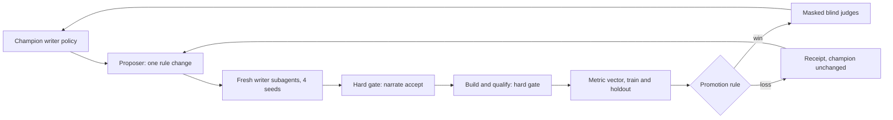

# Realism self-improvement loop

BigLoom builds large DOCX, PDF, and PPTX files that must read like real agency documents. This page
explains the loop that improves the prose in those files. It also states what the loop measured and
what it learned. The design follows WorldLoom `evalrun improve`: change one policy, measure it on a
train set and on an unseen holdout set, and keep the change only when it wins on both.

Status, 23 Oct 2026 10:20 SGT: 15 rounds have run (Round 0 to Round 14). One change was promoted
(Round 2). Round 15 stopped before it had a result, because the writer subagents reached their model
quota. Each round has a receipt in `docs/realism/receipts/`.

## 1. The loop

Each round has six steps:

1. **Proposal.** The proposer subagent reads the train receipts. It writes
   `policies/writer/round-<NNN>.md`, which is the champion policy with one rule changed.
2. **Writing.** Four fresh writer subagents answer the WorldLoom narration requests. Each one sees
   only the text of the candidate policy. Two seeds are train (`2026` at 2 MB, `2027` at 5 MB). Two
   seeds are holdout (`3101` at 2 MB, `3102` at 5 MB).
3. **Fact gate.** `bigloom narrate accept` runs the WorldLoom claim checks. A section with an
   unsupported claim, a typed digit, or an invented entity fails.
4. **Build gate.** `bigloom qualify` builds the files and checks leakage, fact depth, and retrieval.
   The retrieval check requires the target file to rank in the BM25 and TF-IDF top 3 for its query.
5. **Score.** `realism_metrics` measures the metric vector on train and on holdout (section 2).
6. **Decision.** `realism_loop.decide` applies the promotion rule. A promoted candidate then goes to
   three masked blind judges (section 4).

### Promotion rule

A candidate is promoted only when all four conditions are true:

- On train, at least one metric moves closer to the real value by more than its band.
- On train, no metric moves away from the real value by more than its band.
- On holdout, the summed normalised distance to the real values falls.
- The judge guard does not trip.

| Metric | Band |
|---|---|
| `commercial_per_k` | 0.5 |
| `retail_per_k` | 0.3 |
| `wl_id_per_k` | 0.5 |
| `within_file_repeat` | 0.01 |
| `top_opener_share` | 0.01 |
| `unique_sentences` | 5.0 |
| `cross_document_reuse` | 0.01 |

### Rules that do not change

- **Frozen grader.** Each receipt records `grader_sha256`
  (`eeb607b3b32acbfc02a99f24c97da73e0a94d871c1272b4d2e456b66f56dd32b`). The loop stops if the grader
  changes.
- **One change in each round.** A candidate changes one rule of the champion and nothing else.
- **Holdout isolation.** The proposer never sees holdout numbers, holdout seeds, or holdout passages.
- **Fresh writers.** Each round uses new writer subagents. A writer never sees an earlier round's
  `responses.json`.
- **Masked judges.** Product and organisation names are masked (`[PRODUCT-1]`, `[ORG-1]`) on both
  sides of every judge pair.
- **No Vertex AI.** Every model role is a Jetski subagent.

## 2. What the metrics measure, and their limits

The metric vector uses no model calls. Rates are per 1000 words. The real reference comes from 11
real agency files.

| Metric | What it counts | Real value |
|---|---|---|
| `commercial_per_k` | The phrases `gross profit`, `gross margin`, `operating margin`, `EBITDA`, `sales volume` | 0.0 |
| `retail_per_k` | Retail words such as `store`, `SKU`, `footfall` | 0.78 |
| `wl_id_per_k` | WorldLoom ledger IDs such as `FACT-0028` | 0.0 |
| `within_file_repeat` | The share of sentences that repeat in one file | 4.0% |
| `top_opener_share` | The share of sentences that start with the most common three-word opener | 7.4% |
| `unique_sentences` | Distinct sentences in each file | 146.7 |
| `cross_document_reuse` | The share of sentences that also occur in a different document | 0.1% |

Three properties of the corpus limit what a writer policy can change.

**The `commercial_per_k` floor.** The planted chart captions and tables hold fixed commercial
phrases: one in each DOCX, six in each PDF, and one in each PPTX. With zero commercial phrases in the
prose, train `commercial_per_k` is still about 2.0. The champion is at 2.26. Thus this metric cannot
improve by more than its 0.5 band. A promotion must come from `unique_sentences` or
`top_opener_share`.

**PPTX slide footers.** The PPTX renderer makes one slide bullet from each paragraph. Each slide also
has a date footer, which the metric reads as a sentence that starts with `# April #`. A deck has five
such footers. With three paragraphs in each section, a deck has about 16 sentences and the footers
make 31% of the openers. With two paragraphs, a deck has about 10 sentences and the footers make 50%.
Thus fewer paragraphs raise `top_opener_share`, even when the prose is varied.

**BM25 and the word `margin`.** The DOCX image query asks about the chart "Revised gross margin
forecast by business unit". When the PDF and PPTX prose do not use the word `margin`, its BM25 weight
rises. Then a PPTX, whose chart caption holds `margin`, can rank above the target DOCX, and the
retrieval gate fails. This caused the gate failures in Rounds 9, 10, and 12. The single word `margin`
does not count in `commercial_per_k`. Only the two-word phrases count.

## 3. Measured results

The champion is `policies/writer/round-002.md`
(`a60c857a9f108744c69896cf49cd8a56be5a322e8da5729f1d2d2ec5ee6f5b98`).

| Metric | Real | Round 0 train (template writer) | Round 1 train (first writer policy) | Champion train | Champion holdout |
|---|---|---|---|---|---|
| `wl_id_per_k` | 0.0 | 20.50 | 0.00 | 0.00 | 0.00 |
| `commercial_per_k` | 0.0 | 20.44 | 7.55 | 2.26 | 6.30 |
| `retail_per_k` | 0.78 | 1.40 | 0.21 | 0.21 | 0.23 |
| `within_file_repeat` | 4.0% | 16.0% | 4.4% | 3.9% | 4.0% |
| `top_opener_share` | 7.4% | 20.1% | 12.0% | 13.0% | 13.5% |
| `unique_sentences` | 146.7 | 30.5 | 51.3 | 48.8 | 52.0 |
| `cross_document_reuse` | 0.1% | 6.6% | 0.0% | 0.0% | 0.0% |
| Words per MB | 4,032 | 443 | 440 | 435 | 390 |

Most of the gain came before the loop started. The handshake writer and the appendix filter (Round 1)
removed the ledger IDs and the reused template sentences. Round 2 then cut train `commercial_per_k`
from 7.55 to 2.26.

Rounds 3 to 14 did not promote a change. Eight of the twelve candidates passed the hard gates on
both sets. Several candidates gained on holdout. Each one still lost on train, because a second metric got
worse by more than its band.

The files are still far from real on two metrics. Real files have about three times as many distinct
sentences (146.7 against 48.8). Their text is also about nine times more dense (4,032 words per MB
against 435). The masked judges can still tell real from synthetic every time (section 4).

## 4. Blind judges

Three judges each see 20 pairs. Each pair holds one real passage and one synthetic passage, with
names masked. A judge error rate of 50% means the judges cannot tell the two sides apart.

| Round | Correct verdicts | Mean error | Main clues the judges gave |
|---|---|---|---|
| Round 0 (unmasked) | 60 of 60 | 0% | WorldLoom IDs, lineage tables, template phrases |
| Round 1 (unmasked) | 60 of 60 | 0% | Real product and framework names on the real side |
| Round 1 (masked) | 20 of 60 | 67% | Each judge sorted the pairs into two series, and two judges reversed which series was real |
| Round 2 (masked) | 60 of 60 | 0% | PDF extraction marks on the real side, polished narrative tone on the synthetic side |
| Round 11 (masked) | 60 of 60 | 0% | Real external standards and `.gov.sg` domains on the real side, capital letters in mid-sentence fact splices on the synthetic side |

A judge gives one label to a whole document series, so its 20 verdicts are not independent. The judge
guard therefore blocks a promotion only when every judge does better on the candidate and the mean
error falls by more than `JUDGE_BAND` (0.10).

Most judge clues are about the real side (extraction marks, real standards). The prose rules cannot
change those clues.

## 5. What we learned

**One rule change moves two metrics in opposite directions.** Shorter sentences raise
`unique_sentences`, but writers then name `gross profit` once in each new paragraph (Rounds 5, 8,
14). Fewer commercial words lower `commercial_per_k`, but writers then join facts into long compound
sentences of 25 to 30 words, which lowers `unique_sentences` (Rounds 4, 11, 13). Each fix to one metric
made the other metric worse.

**One run for each seed is a noisy test.** Under the same policy, two fresh writers wrote 0 and 32
commercial phrases (Round 5 and Round 8, seeds 2026 and 2027). In Round 7 and Round 11, fresh writers
wrote half the target length. A single run cannot tell a policy effect from writer variance. WorldLoom
found the same problem in its first live pilot.

**The real limits are in the corpus, not in the policy.** The `commercial_per_k` floor, the PPTX
footers, and the BM25 effect (section 2) each come from the planted content or the renderer. The
proposer can only change the writer policy, so it cannot remove them.

**Near misses are discarded.** Rounds 5, 8, 9, and 12 each gained on holdout and improved one or two
train metrics. The loop keeps no archive, so later rounds start again from the champion and cannot
build on these candidates.

**Process errors invalidate a round.** The supervisor stopped four errors: two rules in one round, a
receipt with passages from an earlier round, holdout numbers in a proposer message, and writers
told to copy earlier output. Each affected round ran again from scratch. The rules in section 1 now
prevent these errors.

## 6. Next levers

These changes alter the loop design. They need approval before they are made.

1. **Repeat runs.** Run two writers on each seed and compare the means. This reduces writer variance.
2. **An archive of near misses.** Keep candidates that gained on holdout, and let the proposer start
   from one of them.
3. **A floor-aware band.** Measure `commercial_per_k` on the prose only, or subtract the fixed
   phrases from the planted content.
4. **Fixes in the corpus.** Write the PPTX date footer so that it is not read as a sentence, and keep
   the word `margin` in the PDF so that the BM25 weight does not change.
5. **Round 15.** Run `policies/writer/round-015.md` again after the quota resets. It adds sentence
   length and three-paragraph rules to `QUALITY`. The three paragraphs keep the PPTX bullet count.

## Appendix A. Rounds

The receipt for each row is `docs/realism/receipts/round<N>.json`. It holds the full vectors, the
samples, and the policy digest.

| Round | Change under test | Result | Main reason |
|---|---|---|---|
| 0 | WorldLoom template writer | Baseline | Not applicable |
| 1 | Handshake writer, appendix and ID filter, single-column measure table (`bda2a5cd…`) | Baseline champion | Not applicable |
| 2 | `VOCABULARY`: name commercial measures at most once in a paragraph (`a60c857a…`) | **Promoted** | `commercial_per_k` 7.55 to 2.26 on train |
| 3 | Opener cap and thin-fact procedure rule (`b739d290…`) | Rejected | Two rules in one round. Retrieval gate failed. |
| 4 | Each commercial word once in each section (`b10737ef…`) | Rejected | `unique_sentences` 48.8 to 35.3 |
| 5 | Sentences of 12 to 18 words (`69b1350e…`) | Rejected | `commercial_per_k` 2.26 to 4.78 |
| 6 | Opener cap of two in each document (`41278114…`) | Rejected | A reused writer carried Round 5 text |
| 7 | Each commercial measure once in each section, fresh writers (`5fd47221…`) | Rejected | Writers wrote half length, `unique_sentences` 29.2 |
| 8 | Word and sentence floor in each section (`8c9f8b23…`) | Rejected | `commercial_per_k` 2.26 to 4.09 |
| 9 | Commercial words once in each document (`e940cc6a…`) | Rejected | Retrieval gate failed (BM25 effect) |
| 10 | `gross margin` once in each section of one document (`db8c8714…`) | Rejected | Retrieval gate failed (BM25 effect) |
| 11 | `gross margin` in three named sections (`75139cfa…`) | Rejected | Wrong section names, `unique_sentences` 31.2 |
| 12 | Sentences of 12 to 16 words (`8e383634…`) | Rejected | Retrieval gate failed on one seed |
| 13 | `gross margin` in four named sections (`1bb77be6…`) | Rejected | `unique_sentences` 48.8 to 38.5 |
| 14 | Two paragraphs of short sentences in each section (`89a09a12…`) | Rejected | `commercial_per_k` 3.48, PPTX footers raised `top_opener_share` to 16.6% |
| 15 | Short sentences in three paragraphs | Not run | Writer quota reached |

## Appendix B. Files

| File | Purpose |
|---|---|
| `src/bigloom/realism_metrics.py` | The metric vector and the grader digest |
| `src/bigloom/realism_loop.py` | Train and holdout preparation, build runner, promotion rule, receipt writer |
| `src/bigloom/realism_pairs.py` | Masked blind pair builder, scorer, and sample extractor |
| `src/bigloom/realism.py` | Realism findings for each file, checked by `bigloom qualify` |
| `src/bigloom/formats/longform_filter.py` | The appendix and WorldLoom ID filter |
| `policies/PROPOSER.md` | Instructions for the proposer subagent |
| `policies/writer/round-001.md` to `round-014.md` | Versioned writer policies |
| `docs/realism/receipts/round0.json` to `round14.json` | Full round receipts |
| `docs/realism/loop/train-002.json` to `train-014.json` | Train-only receipts that the proposer reads |
